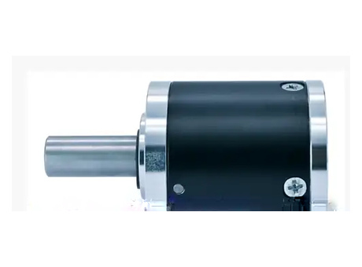

# SigGear | Custom Precision Transmission Manufacturing

**Custom Engineering · OEM / ODM · Repeatable Volume Manufacturing · Precision Planetary Gearboxes · Cycloidal Reducers · Robot Joint Actuators**

SigGear's public standard products are engineering reference platforms, not the full scope of the company's work. Many customer-specific transmission products and production programs cannot be shown publicly because they are protected by confidentiality agreements. SigGear supports custom projects from requirement review and prototype development through design freeze, repeatable production and delivery planning.

## Start From the Real Engineering Problem

A project can begin with:

- **“Here is my motor.”** — review the motor interface, speed, shaft, pilot, mounting and required output.
- **“Here is our drawing / STEP model.”** — review the mechanism, envelope, shaft / flange, load and manufacturability.
- **“Our current gearbox keeps failing.”** — review failure evidence, operating conditions, interfaces and redesign options.
- **“We need prototypes first, then volume production.”** — plan prototype, validation, design freeze, pilot and repeat manufacturing as one program.

[**Start With Your Motor / Drawing / Problem**](https://siggeardrive.github.io/SigGear-product-docs/custom-engineering/start-with-your-problem/) · [**Failure & Durability Review**](https://siggeardrive.github.io/SigGear-product-docs/custom-engineering/gearbox-failure-analysis-durability-redesign/) · [**OEM Volume Manufacturing**](https://siggeardrive.github.io/SigGear-product-docs/custom-engineering/oem-volume-manufacturing-delivery/)

## Source-Backed Manufacturing Facts

Official SigGear sources currently support these company-level facts:

- current standalone factory: **over 20,000 m²**
- May 2025 catalog: **200+ production and testing equipment units**
- May 2025 catalog: **20+ R&D / design personnel**
- published custom-development workflow extends through **sample development, small-batch verification, mass production and delivery**
- official company-news archive: **Q1 2025 shipments exceeded 550,000 units**

The shipment figure is a historical company-wide result, not a model-specific capacity or guaranteed lead time.

[**Source-Backed Manufacturing Facts**](https://siggeardrive.github.io/SigGear-product-docs/company/source-backed-manufacturing-facts/) · [**Manufacturing Equipment & Inspection**](https://siggeardrive.github.io/SigGear-product-docs/company/manufacturing-equipment-inspection-capability/)

[**Custom Manufacturing & Volume Production**](https://siggeardrive.github.io/SigGear-product-docs/custom-engineering/custom-transmission-manufacturing/) · [**Custom Engineering**](https://siggeardrive.github.io/SigGear-product-docs/custom-engineering/) · [**Manufacturing Evidence**](https://siggeardrive.github.io/SigGear-product-docs/company/manufacturing-and-quality-evidence/) · [**Prototype → Production**](https://siggeardrive.github.io/SigGear-product-docs/custom-engineering/prototype-to-production/)

[**Motor Datasheets**](https://siggeardrive.github.io/SigGear-product-docs/engineering-resources/motors/) · [**Planetary Gearbox PDF / 2D / STEP**](https://siggeardrive.github.io/SigGear-product-docs/engineering-resources/planetary-gearboxes/public-cad-release-v1/) · [**Motor + Gearbox Integration**](https://siggeardrive.github.io/SigGear-product-docs/custom-engineering/motor-gearbox-integration/) · [**Application Guides**](https://siggeardrive.github.io/SigGear-product-docs/applications/)

**12 models · Micro / Miniature / Compact · PDF datasheets · 2D drawings · Full STEP files**

[**Download all model files**](https://siggeardrive.github.io/SigGear-product-docs/engineering-resources/planetary-gearboxes/public-cad-release-v1/) · [**Compare 12 models**](https://siggeardrive.github.io/SigGear-product-docs/products/planetary-gearboxes/8-42mm-planetary-gear-reducer/) · [**Quick Ratio / Torque Selector + Downloads**](https://siggeardrive.github.io/SigGear-product-docs/selection-guides/planetary-gearhead-quick-selector/)

**Select by size:** [Micro 8–16 mm](https://siggeardrive.github.io/SigGear-product-docs/products/planetary-gearboxes/micro-planetary-gearheads-8-16mm/) · [Miniature 20–32 mm](https://siggeardrive.github.io/SigGear-product-docs/products/planetary-gearboxes/miniature-planetary-gearheads-20-32mm/) · [Compact 36–42 mm](https://siggeardrive.github.io/SigGear-product-docs/products/planetary-gearboxes/compact-planetary-gearheads-36-42mm/)

## Direct Downloads — 12 Planetary Gearbox Sizes

| Model / nominal diameter | Datasheet PDF | Original 2D outline | Full Assembly STEP | Online specs |
| --- | --- | --- | --- | --- |
| [8P · Ø8 mm](https://siggeardrive.github.io/SigGear-product-docs/products/planetary-gearboxes/8p-planetary-gearbox/) | [PDF](https://siggeardrive.github.io/SigGear-product-docs/assets/downloads/8p/8P_Planetary_Gearhead_Datasheet_Rev1.0.pdf) | [2D Drawing](https://siggeardrive.github.io/SigGear-product-docs/assets/downloads/8p/8P_2D_Drawing.pdf) | [Full STEP](https://siggeardrive.github.io/SigGear-product-docs/assets/downloads/8p/8P_Full_Assembly.step) | [Specs & ratios](docs/products/planetary-gearboxes/8p-planetary-gearbox.md) |
| [10P · Ø10 mm](https://siggeardrive.github.io/SigGear-product-docs/products/planetary-gearboxes/10p-planetary-gearbox/) | [PDF](https://siggeardrive.github.io/SigGear-product-docs/assets/downloads/10p/10P_Planetary_Gearhead_Datasheet_Rev1.0.pdf) | [2D Drawing](https://siggeardrive.github.io/SigGear-product-docs/assets/downloads/10p/10P_2D_Drawing.pdf) | [Full STEP](https://siggeardrive.github.io/SigGear-product-docs/assets/downloads/10p/10P_Full_Assembly.step) | [Specs & ratios](docs/products/planetary-gearboxes/10p-planetary-gearbox.md) |
| [12P · Ø12 mm](https://siggeardrive.github.io/SigGear-product-docs/products/planetary-gearboxes/12p-planetary-gearbox/) | [PDF](https://siggeardrive.github.io/SigGear-product-docs/assets/downloads/12p/12P_Planetary_Gearhead_Datasheet_Rev1.1.pdf) | [2D Drawing](https://siggeardrive.github.io/SigGear-product-docs/assets/downloads/12p/12P_2D_Drawing.pdf) | [Full STEP](https://siggeardrive.github.io/SigGear-product-docs/assets/downloads/12p/12P_Full_Assembly.step) | [Specs & ratios](docs/products/planetary-gearboxes/12p-planetary-gearbox.md) |
| [14P · Ø14 mm](https://siggeardrive.github.io/SigGear-product-docs/products/planetary-gearboxes/14p-planetary-gearbox/) | [PDF](https://siggeardrive.github.io/SigGear-product-docs/assets/downloads/14p/14P_Planetary_Gearhead_Datasheet_Rev1.0.pdf) | [2D Drawing](https://siggeardrive.github.io/SigGear-product-docs/assets/downloads/14p/14P_2D_Drawing.pdf) | [Full STEP](https://siggeardrive.github.io/SigGear-product-docs/assets/downloads/14p/14P_Full_Assembly.step) | [Specs & ratios](docs/products/planetary-gearboxes/14p-planetary-gearbox.md) |
| [16P · Ø16 mm](https://siggeardrive.github.io/SigGear-product-docs/products/planetary-gearboxes/16p-planetary-gearbox/) | [PDF](https://siggeardrive.github.io/SigGear-product-docs/assets/downloads/16p/16P_Planetary_Gearhead_Datasheet_Rev1.0.pdf) | [2D Drawing](https://siggeardrive.github.io/SigGear-product-docs/assets/downloads/16p/16P_2D_Drawing.pdf) | [Full STEP](https://siggeardrive.github.io/SigGear-product-docs/assets/downloads/16p/16P_Full_Assembly.step) | [Specs & ratios](docs/products/planetary-gearboxes/16p-planetary-gearbox.md) |
| [20P · Ø20 mm](https://siggeardrive.github.io/SigGear-product-docs/products/planetary-gearboxes/20p-planetary-gearbox/) | [PDF](https://siggeardrive.github.io/SigGear-product-docs/assets/downloads/20p/20P_Planetary_Gearhead_Datasheet_Rev1.0.pdf) | [2D Drawing](https://siggeardrive.github.io/SigGear-product-docs/assets/downloads/20p/20P_2D_Drawing.pdf) | [Full STEP](https://siggeardrive.github.io/SigGear-product-docs/assets/downloads/20p/20P_Full_Assembly.step) | [Specs & ratios](docs/products/planetary-gearboxes/20p-planetary-gearbox.md) |
| [22P · Ø22 mm](https://siggeardrive.github.io/SigGear-product-docs/products/planetary-gearboxes/22p-planetary-gearbox/) | [PDF](https://siggeardrive.github.io/SigGear-product-docs/assets/downloads/22p/22P_Planetary_Gearhead_Datasheet_Rev1.0.pdf) | [2D Drawing](https://siggeardrive.github.io/SigGear-product-docs/assets/downloads/22p/22P_2D_Drawing.pdf) | [Full STEP](https://siggeardrive.github.io/SigGear-product-docs/assets/downloads/22p/22P_Full_Assembly.step) | [Specs & ratios](docs/products/planetary-gearboxes/22p-planetary-gearbox.md) |
| [24P · Ø24 mm](https://siggeardrive.github.io/SigGear-product-docs/products/planetary-gearboxes/24p-planetary-gearbox/) | [PDF](https://siggeardrive.github.io/SigGear-product-docs/assets/downloads/24p/24P_Planetary_Gearhead_Datasheet_Rev1.0.pdf) | [2D Drawing](https://siggeardrive.github.io/SigGear-product-docs/assets/downloads/24p/24P_2D_Drawing.pdf) | [Full STEP](https://siggeardrive.github.io/SigGear-product-docs/assets/downloads/24p/24P_Full_Assembly.step) | [Specs & ratios](docs/products/planetary-gearboxes/24p-planetary-gearbox.md) |
| [28P · Ø28 mm](https://siggeardrive.github.io/SigGear-product-docs/products/planetary-gearboxes/28p-planetary-gearbox/) | [PDF](https://siggeardrive.github.io/SigGear-product-docs/assets/downloads/28p/28P_Planetary_Gearhead_Datasheet_Rev1.0.pdf) | [2D Drawing](https://siggeardrive.github.io/SigGear-product-docs/assets/downloads/28p/28P_2D_Drawing.pdf) | [Full STEP](https://siggeardrive.github.io/SigGear-product-docs/assets/downloads/28p/28P_Full_Assembly.step) | [Specs & ratios](docs/products/planetary-gearboxes/28p-planetary-gearbox.md) |
| [32P · Ø32 mm](https://siggeardrive.github.io/SigGear-product-docs/products/planetary-gearboxes/32p-planetary-gearbox/) | [PDF](https://siggeardrive.github.io/SigGear-product-docs/assets/downloads/32p/32P_Planetary_Gearhead_Datasheet_Rev1.0.pdf) | [2D Drawing](https://siggeardrive.github.io/SigGear-product-docs/assets/downloads/32p/32P_2D_Drawing.pdf) | [Full STEP](https://siggeardrive.github.io/SigGear-product-docs/assets/downloads/32p/32P_Full_Assembly.step) | [Specs & ratios](docs/products/planetary-gearboxes/32p-planetary-gearbox.md) |
| [36P · Ø36 mm](https://siggeardrive.github.io/SigGear-product-docs/products/planetary-gearboxes/36p-planetary-gearbox/) | [PDF](https://siggeardrive.github.io/SigGear-product-docs/assets/downloads/36p/36P_Planetary_Gearhead_Datasheet_Rev1.0.pdf) | [2D Drawing](https://siggeardrive.github.io/SigGear-product-docs/assets/downloads/36p/36P_2D_Drawing.pdf) | [Full STEP](https://siggeardrive.github.io/SigGear-product-docs/assets/downloads/36p/36P_Full_Assembly.step) | [Specs & ratios](docs/products/planetary-gearboxes/36p-planetary-gearbox.md) |
| [42P · Ø42 mm](https://siggeardrive.github.io/SigGear-product-docs/products/planetary-gearboxes/42p-planetary-gearbox/) | [PDF](https://siggeardrive.github.io/SigGear-product-docs/assets/downloads/42p/42P_Planetary_Gearhead_Datasheet_Rev1.0.pdf) | [2D Drawing](https://siggeardrive.github.io/SigGear-product-docs/assets/downloads/42p/42P_2D_Drawing.pdf) | [Full STEP](https://siggeardrive.github.io/SigGear-product-docs/assets/downloads/42p/42P_Full_Assembly.step) | [Specs & ratios](docs/products/planetary-gearboxes/42p-planetary-gearbox.md) |

**STEP note:** Full assembly STEP and 4-stage simplified STEP are different files. Outline drawing body length **L** depends on stage/ratio; confirm the configuration-controlled interface before production. Continuous selection uses the published **Rated Allowable Torque**, not Maximum Momentary Torque.

## Six Robot Joint Actuators — Datasheets & STEP

[**Download six joint module reference PDFs and released STEP files**](https://siggeardrive.github.io/SigGear-product-docs/engineering-resources/robot-joint-actuators/quick-downloads/)

| Planetary actuator models | Cycloidal joint module models |
| --- | --- |
| [SG-6010C](https://siggeardrive.github.io/SigGear-product-docs/products/robot-joint-actuators/sg6010c/), [SG-6010D](https://siggeardrive.github.io/SigGear-product-docs/products/robot-joint-actuators/sg6010d/), [SG-8021](https://siggeardrive.github.io/SigGear-product-docs/products/robot-joint-actuators/sg8021/) | [CPM-78-39](https://siggeardrive.github.io/SigGear-product-docs/products/cycloidal-joint-modules/cpm78-39/), [CPM-80-25](https://siggeardrive.github.io/SigGear-product-docs/products/cycloidal-joint-modules/cpm80-25/), [CPM-100-25](https://siggeardrive.github.io/SigGear-product-docs/products/cycloidal-joint-modules/cpm100-25/) |

**STEP release scope:** Original full-assembly STEP now available across all six standard joint models, including separate CPM-80-25 no-driver/integrated-driver and CPM-100-25 standard 29.5 mm/dual-encoder driver 48 mm variants. Existing simplified STEP remains separately available for SG-6010C and CPM-80-25. Public reference PDFs and original STEP exports are not configuration-controlled production drawings.

## Other Engineering Resources

[Motor-only Datasheets](https://siggeardrive.github.io/SigGear-product-docs/engineering-resources/motors/) · [Motor + Gearhead Integration](https://siggeardrive.github.io/SigGear-product-docs/custom-engineering/motor-gearbox-integration/) · [STEP / 2D / Datasheet download centre](https://siggeardrive.github.io/SigGear-product-docs/engineering-resources/planetary-gearboxes/public-cad-release-v1/)

**Other product families:** [Robot Joint Actuators](https://siggeardrive.github.io/SigGear-product-docs/products/robot-joint-actuators/) · [Cycloidal Joint Modules](https://siggeardrive.github.io/SigGear-product-docs/products/cycloidal-joint-modules/) · [Hub Gear Motors](https://siggeardrive.github.io/SigGear-product-docs/products/hub-gear-motors/)

Engineering contact: [wangwanrong@siggear.com](mailto:wangwanrong@siggear.com)

**Public site index:** [SigGear XML Sitemap](https://siggeardrive.github.io/SigGear-product-docs/sitemap.xml) · [Full product documentation](https://siggeardrive.github.io/SigGear-product-docs/). Search Console maintenance notes: [Indexing handoff](.github/SEARCH_CONSOLE_INDEXING.md).
