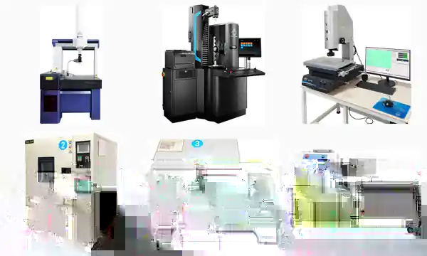

# SigGear Testing, Metrology & Validation Evidence

This page separates three different things that are often mixed together in gearbox marketing:

1. **test and inspection capability**
2. **real measured test records**
3. **published product specifications**

They are not interchangeable. A photograph of test equipment does not create a product specification, and a measured result from one model must not be transferred to another model.

*Selected real equipment images from SigGear company material. They show dimensional metrology, gear inspection / measurement, environmental test equipment and a transmission test fixture. The image demonstrates physical testing and inspection capability; it is not a model-specific test report.*

## Documented Testing and Inspection Scope

SigGear company equipment material documents testing and inspection resources including:

- coordinate measuring equipment
- gear inspection equipment
- gear meshing inspection
- optical / two-dimensional measurement
- brushless-motor comprehensive testing
- dynamometer and eddy-current dynamometer testing
- concentricity measurement
- backlash inspection
- high-low temperature testing
- thermal-shock testing
- quiet-room acoustic testing
- salt-spray testing
- microscopy and other dimensional inspection

The applicable equipment, fixture, test method and acceptance criteria depend on the product and project requirement.

## Released Public Test Records

Only source-backed results that have been reviewed for public use are treated as public test evidence.

### CPM-80-25 Measured Dynamometer Data

The current public CPM-80-25 performance page contains representative measured dynamometer points at 24 V, 36 V and 48 V.

These are measured observations under the documented test setup. They are **not** generic SigGear gearbox performance values and must not be transferred to the miniature planetary series.

[View CPM-80-25 Measured Performance Data](../engineering-resources/cpm80-25/performance-test-data.md){ .md-button .md-button--primary }

### SG-6010HB Thermal Test Record

The current public SG-6010HB thermal record publishes source-backed temperature-rise timing under documented stall and 110 rpm load conditions.

The page intentionally leaves undefined source fields uninterpreted instead of converting them into unsupported specifications.

[View SG-6010HB Thermal Test Record](../engineering-resources/sg6010hb/thermal-test-record.md){ .md-button }

## 8P-42P Planetary Gearbox Evidence Boundary

The 8P-42P planetary gearbox series already has public model pages, Datasheets, Mechanical Interface references, simplified STEP CAD and real product photographs.

However, this website does **not** currently publish one universal torque-efficiency curve, noise curve, lifetime result or backlash test report that applies across all 12 planetary frame sizes.

Do not transfer:

- CPM-80-25 dynamometer data
- SG-6010HB thermal data
- another planetary frame size's measured result
- a single sample result from one ratio or stage count

to a different 8P-42P configuration.

For a planetary gearbox test result to become public engineering evidence, the test record should identify the exact configuration and conditions.

## Minimum Record for a Planetary Gearbox Test

A useful public test record should normally include:

- exact gearbox model / frame size
- reduction ratio
- stage count
- motor model or input source
- supply voltage and current limit where applicable
- input speed
- measured output speed
- applied output torque or load
- temperature / ambient condition where relevant
- test equipment or measurement method
- sample or configuration identification
- test date or source revision
- clear distinction between measured points and rated specifications

For torque-efficiency testing, input power, output torque, output speed and the efficiency calculation basis should all be traceable to the same test setup.

## How Test Evidence Is Used

Test evidence supports engineering evaluation, but final Design-In should still match the customer's:

- motor
- ratio and stage count
- duty cycle
- continuous and peak load
- mounting condition
- ambient and cooling condition
- life / cycle target
- noise or backlash acceptance criteria

A source-backed test can support a decision. It should not be expanded into a broader claim than the test actually proves.

## Related Evidence

[Manufacturing & Quality Evidence](../company/manufacturing-and-quality-evidence.md){ .md-button }
[8–42 mm Planetary Gearbox Series](../products/planetary-gearboxes/8-42mm-planetary-gear-reducer.md){ .md-button .md-button--primary }
[Sample Validation Workflow](sample-validation-workflow.md){ .md-button }
[Design-In Checklist](design-in-checklist.md){ .md-button }
[Request CAD, Sample and Quote](../request-cad-sample-quote.md){ .md-button }

## Engineering Contact

**Wanrong Wang**  
International Sales / Sales Engineer, SigGear  
[wangwanrong@siggear.com](mailto:wangwanrong@siggear.com)
