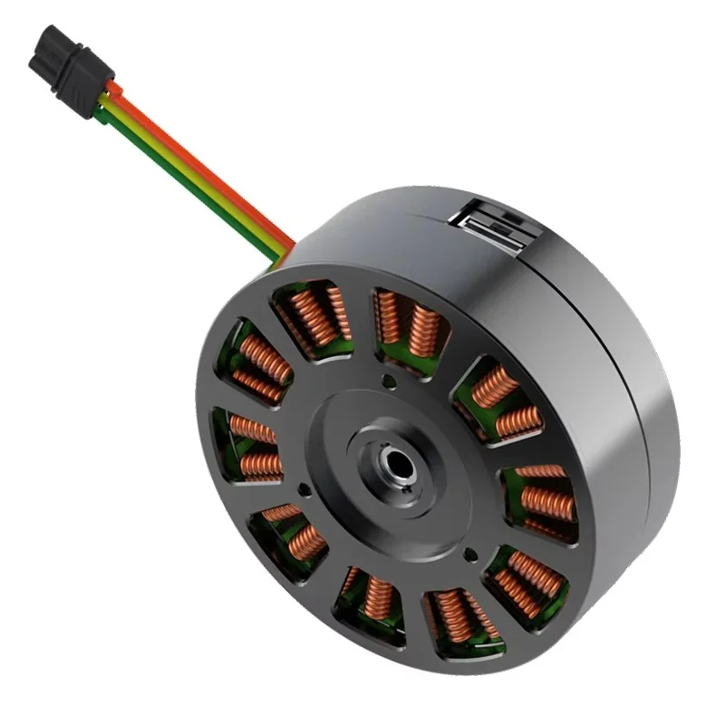
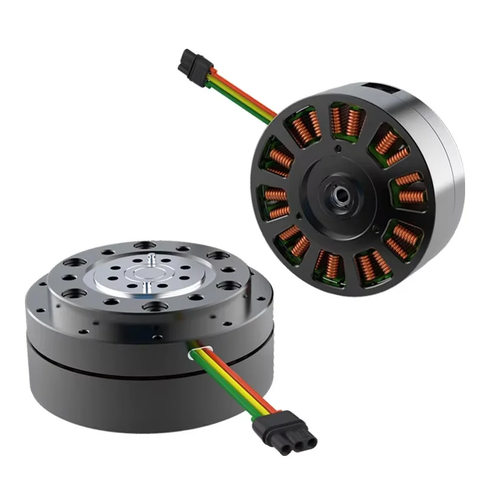
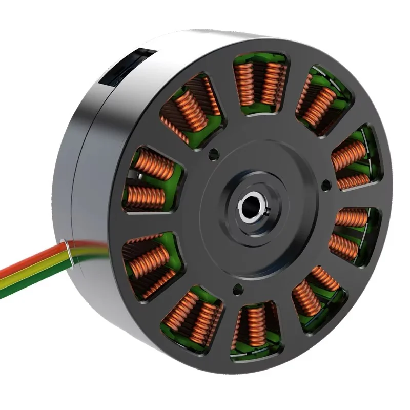

# CPM-78-39 | Cycloidal Robot Joint Module

[**Download Datasheet PDF · Rev 0.1**](../../assets/downloads/joint-actuators/CPM-78-39_Public_Reference_Datasheet_Rev0.1.pdf){ .md-button .md-button--primary }
[**2D Reference Drawing PDF · Internal SG2368B**](../../assets/downloads/joint-actuators/CPM-78-39_SG2368B_2D_Reference_Drawing.pdf){ .md-button }

[**Download Original Full Assembly STEP**](../../assets/downloads/joint-actuators/CPM-78-39_Original_Full_Assembly_20261118.step){ .md-button }
[Mechanical Interface](../../engineering-resources/cpm78-39/mechanical-interface.md){ .md-button }

| Specification | Published value |
| --- | --- |
| Outer Diameter | 78.7 mm |
| Product Thickness | 35.8 mm |
| Reduction Ratio | 39:1 |
| Backlash | 5–10 arcmin |
| Operating Voltage | 36 VDC |
| Rated Output Speed | 48 rpm |
| Rated Output Torque | 20 Nm |
| Peak Output Torque | 52 Nm |

  <figure><figcaption>Output-side reference</figcaption></figure>
  <figure><figcaption>Motor-side reference</figcaption></figure>

3 additional product reference views

  <figure><figcaption>Two views</figcaption></figure>
  <figure><figcaption>Motor-side angle</figcaption></figure>
  <figure><figcaption>Internal illustration</figcaption></figure>

**2D source:** SG2368B reference drawing matches 39:1, Ø78.7 × 35.8 mm; confirm internal model equivalence and mounting revision before production. **CAD:** original assembly STEP available.

Full published parameter table

| Additional specification | Published value |
| --- | --- |
| Transmission Structure | Cycloidal pinwheel |
| Rated Motor Power | 200 W |
| No Load Output Speed | 54 rpm |
| Weight | 600 g |

<small>**Configuration:** Standard uses Hall sensors; no integrated driver or absolute encoder. **Rated ≠ peak:** Peak torque is not a continuous rating. The downloadable PDF is a public reference summary, not a production-controlled specification. Verify mounting dimensions, duty cycle and electrical configuration before design-in.</small>

[Detailed technical reference](../../engineering-resources/cpm78-39/datasheet.md) · [All six joint modules](../../engineering-resources/robot-joint-actuators/quick-downloads.md)
