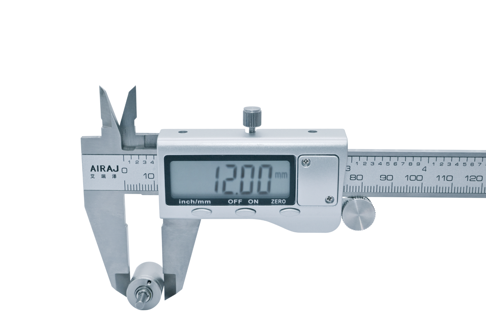

# 12 mm Micro Precision Planetary Gearhead (12P)

[**Download Datasheet PDF**](../../assets/downloads/12p/12P_Planetary_Gearhead_Datasheet_Rev1.1.pdf){ .md-button .md-button--primary }
[**Download 2D Drawing PDF**](../../assets/downloads/12p/12P_2D_Drawing.pdf){ .md-button }
[**Download Full Assembly STEP**](../../assets/downloads/12p/12P_Full_Assembly.step){ .md-button }
[**Download Simplified 4-Stage STEP · Reference**](../../assets/downloads/12p/12P_Public_Simplified_STEP_v1.0_4-Stage.step){ .md-button }

**Engineering data reference:** Use the current [12P Datasheet PDF](../../assets/downloads/12p/12P_Planetary_Gearhead_Datasheet_Rev1.1.pdf) for published input-speed conditions, ratio/stage, rated load and dimensions. Images here show real products only; if a web summary and the downloadable Datasheet differ, verify the latest controlled revision with SigGear engineering.

| Ø Diameter | Reduction ratios | Gearhead body length | Rated allowable torque | Backlash |
| --- | --- | --- | --- | --- |
| **12 mm** | **3.5:1–509.1:1** | **11.35–19.60 mm** | **196.1–411.9 mN·m** | **≤ 1.5°** |

**Custom 12P interface or motor fit?** [Match my motor](../../request-cad-sample-quote.md?model=12P&start=existing_motor&path=gearbox_only) · [Review my drawing / STEP](../../request-cad-sample-quote.md?model=12P&start=drawing_cad) · [Replace / redesign existing gearbox](../../request-cad-sample-quote.md?model=12P&start=failing_gearbox&path=gearbox_only) · [Prototype → volume](../../request-cad-sample-quote.md?model=12P&start=prototype_to_volume)

**More:** [Stage-by-stage ratios](#stage-ratio-and-performance-table) · [Online technical specifications](../../engineering-resources/12p/datasheet.md) · [Official 2D Drawing PDF](../../assets/downloads/12p/12P_2D_Drawing.pdf) · [Motor-only datasheets](../../engineering-resources/motors/index.md#12-mm-coreless-bldc-motor) · [All 12 models](8-42mm-planetary-gear-reducer.md)

{ width="520" loading="lazy" }

## Product Identity

| Item | Description |
| --- | --- |
| Model | 12P |
| Product type | Micro precision planetary gearhead (planetary gearbox) |
| Nominal outer diameter | 12 mm |
| Number of stages | 1 to 4 |
| Housing material | Steel |
| Gearwheel material | Steel |
| Output bearing | Ball Bearing |

## Key Specifications

| Parameter | Published value |
| --- | ---: |
| Nominal outer diameter | 12 mm |
| Gearhead length range | 11.35–19.60 mm |
| Reduction ratio range | 3.5:1–509.1:1 |
| Rated allowable torque range | 196.1–411.9 mN·m |
| Maximum momentary torque range | 392.3–823.8 mN·m |
| Efficiency range | 66–90% |
| Backlash at no load | ≤ 1.5° |
| Permissible gearhead input speed, continuous operation | 1,000–50,000 rpm |
| Operating temperature | −40 to 120 °C |

Maximum momentary torque is not a continuous working rating.

## Stage, Ratio and Performance Table

| Stages | Gearhead length L | Available reduction ratios | Rated allowable torque | Maximum momentary torque | Efficiency |
| ---: | ---: | --- | ---: | ---: | ---: |
| 1 | 11.35 mm | 3.5 / 4 / 4.75 | 196.1 mN·m | 392.3 mN·m | 90% |
| 2 | 14.10 mm | 12.25 / 14 / 16 / 16.6 / 19 / 22.6 | 294.2 mN·m | 588.4 mN·m | 80% |
| 3 | 16.85 mm | 42.9 / 49 / 56 / 58.2 / 64 / 66.5 / 76 / 79 / 90.25 / 107.2 | 353.0 mN·m | 706.1 mN·m | 73% |
| 4 | 19.60 mm | 150.1 / 171.5 / 196 / 203.7 / 224 / 232.7 / 256 / 266 / 276.4 / 304 / 315.9 / 361 / 375.1 / 428.7 / 509.1 | 411.9 mN·m | 823.8 mN·m | 66% |

## Shaft and Load Limits

| Parameter | Published value |
| --- | ---: |
| Radial load, measured 10 mm from flange | ≤ 0.8 kgf |
| Shaft axial load | ≤ 0.25 kgf |
| Thrust shaft play | ≤ 0.04 mm |

The supplied 12P mechanical-detail sheet does not state a radial shaft-play value, so none is inferred from another frame size.

## Motor Compatibility

For **motor + gearhead matching**, use the downloadable [gearhead Datasheet](../../assets/downloads/12p/12P_Planetary_Gearhead_Datasheet_Rev1.1.pdf) and the [motor Datasheet library](../../engineering-resources/motors/index.md). Motor voltage/power, shaft/pinion, pilot, mounting, input speed and duty-cycle compatibility must be confirmed for the exact combination; older marketing charts are not a technical specification.

## Dimensions and Interface

The published drawing shows a 12 mm body, a 10.00 mm output-shaft extension and stage-dependent gearhead lengths of 11.35, 14.10, 16.85 and 19.60 mm. Download the official **2D Drawing PDF** above for the complete shaft, mounting, input-interface and tolerance notation.

## STEP Notes

The Full Assembly STEP is the original Creo assembly export for 12P, now available for direct download. The separate Simplified STEP is a 4-stage reference model for preliminary packaging. For dimensional verification, use the downloadable **2D Drawing PDF** and confirm its controlled production revision.

[Back to the 8–42 mm product catalogue](8-42mm-planetary-gear-reducer.md)

**Potential OEM applications** *(suitability requires engineering review)*: [Smart toilet lid and nozzle motion](../../applications/smart-toilet-bidet-planetary-gear-motors.md) · [Pet feeder augers](../../applications/smart-pet-feeder-litter-box-planetary-gearheads.md) · [Small pump and valve drives](../../applications/pump-valve-fluid-control-gear-motors.md) · [Electronics inspection](../../applications/semiconductor-electronics-inspection-equipment-gear-motors.md) · [All applications](../../applications/index.md).

**Motor + Gearhead Assembly:** [Motor matching and custom integration](../../custom-engineering/motor-gearbox-integration.md).
