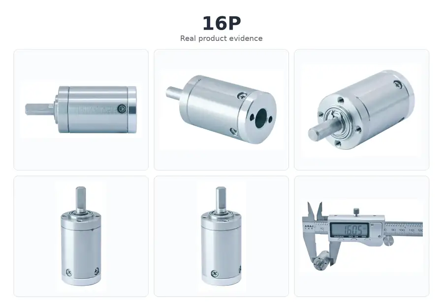

# 16 mm Micro Planetary Gearbox (16P)

## Product Overview

The SigGear 16P is a 16 mm micro planetary gearbox for compact motorized mechanisms. The published configurations cover one to four stages, with reduction ratios from 3.85:1 to 459.5:1.

## Real Product Evidence

*Real 16P frame-size product photographed from multiple angles. The caliper photo is a visual diameter reference for the photographed sample and does not replace the controlled dimensional drawing or released tolerances for a confirmed configuration.*

## Engineering Selection and CAD Access

The 16P is a **16 mm micro planetary gearbox / planetary gearhead**. Its published **17.55–30.45 mm** gearbox body-length range and **3.85:1–459.5:1** ratio range cover different stage configurations, not one interchangeable housing. Before placing a model into a tightly packaged OEM design, confirm the selected stage count, output shaft and motor-side interface against the corresponding drawing.

**Design-In files:** [16P Technical Datasheet](../../engineering-resources/16p/datasheet.md) · [16P Mechanical Interface](../../engineering-resources/16p/mechanical-interface.md)

[Download 16P Public Simplified STEP — 4-Stage Reference](../../assets/downloads/16p/16P_Public_Simplified_STEP_v1.0_4-Stage.step){ .md-button .md-button--primary }
[Request 16P Configuration Review](../../request-cad-sample-quote.md){ .md-button }

The downloadable STEP represents the **4-stage reference configuration only** and is intended for preliminary mechanical packaging. It is **not** a dimensionally interchangeable 1-, 2- or 3-stage model. Request configuration-matched CAD and a controlled drawing before design freeze.

## Product Identity

| Item | Description |
| --- | --- |
| Model | 16P |
| Product type | Micro planetary gearbox |
| Nominal outer diameter | 16 mm |
| Number of stages | 1 to 4 |
| Housing material | Steel |
| Gearwheel material | Steel |
| Output bearing | Ball bearing |

## Key Specifications

| Parameter | Published value |
| --- | ---: |
| Nominal outer diameter | 16 mm |
| Gearbox length range | 17.55–30.45 mm |
| Reduction ratio range | 3.85:1–459.5:1 |
| Rated allowable torque range | 4.0–9.0 kgf·cm |
| Maximum momentary torque range | 8.0–26.0 kgf·cm |
| Efficiency range | 66–90% |
| Backlash at no load | ≤ 1.5° |
| Maximum permissible speed, continuous operation | ≤ 8,000 rpm |
| Operating temperature | −40 to 120 °C |

Torque values are preserved in the source unit, kgf·cm. Maximum momentary torque is not a continuous working rating.

## Stage, Ratio and Performance Table

| Stages | Gearbox length L | Available reduction ratios | Rated allowable torque | Maximum momentary torque | Efficiency |
| ---: | ---: | --- | ---: | ---: | ---: |
| 1 | 17.55 mm | 3.85 / 4.33 / 4.63 | 4.0 kgf·cm | 8.0 kgf·cm | 90% |
| 2 | 21.85 mm | 14.8 / 16.7 / 17.8 / 18.7 / 20 / 21.4 | 5.0 kgf·cm | 10.0 kgf·cm | 80% |
| 3 | 26.15 mm | 57.1 / 64.2 / 68.6 / 72.2 / 77.2 / 81.2 / 82.5 / 86.8 / 92.8 / 99.25 | 7.0 kgf·cm | 20.0 kgf·cm | 73% |
| 4 | 30.45 mm | 219.7 / 247 / 264.2 / 277.9 / 297.2 / 312.55 / 317.75 / 334.2 / 351.5 / 357.4 / 375.9 / 382.1 / 401.9 / 429.8 / 459.5 | 9.0 kgf·cm | 26.0 kgf·cm | 66% |

## Shaft and Load Limits

| Parameter | Published value |
| --- | ---: |
| Radial load, measured 10 mm from flange | ≤ 1.6 kgf |
| Shaft axial load | ≤ 0.5 kgf |
| Radial shaft play | ≤ 0.04 mm |
| Thrust shaft play | ≤ 0.2 mm |

## Motor Compatibility

The detailed adapted-motor sheet identifies DC motors with a nominal voltage of **3–36 VDC** and power **below 10 W**. If a motor cannot meet the gearbox installation requirements, motor matching must be negotiated separately.

The summary artwork expresses the motor-power limit as “≤ 10 W,” while the detailed adapted-motor sheet says “less than 10 W.” This page uses the stricter **below 10 W** condition until the boundary is technically reconciled.

These are adapted-motor conditions, not an electrical voltage or power rating for the mechanical gearbox itself. Confirm the motor shaft, mounting interface, input speed, duty cycle and operating point for the selected gearbox ratio.

## Dimensions and Interface

The published drawing shows a 16 mm body, an 11.6 mm output-shaft extension and stage-dependent gearbox lengths of 17.55, 21.85, 26.15 and 30.45 mm. Use the drawing below for the complete shaft, mounting, input-interface and tolerance notation.

## Typical Applications

- Micro robotics and compact actuators
- Medical and laboratory automation mechanisms
- Precision instruments and optical adjustment mechanisms
- Mini pumps and valve drives
- Compact grippers and smart hardware

Application suitability depends on the selected ratio, motor, load direction, duty cycle, installation and required service life.

## Supply Configuration

SigGear can supply the **16P 16 mm planetary gearbox as a gearbox-only unit**, subject to the selected ratio and mechanical interface. This route is relevant if you already have a motor and need to evaluate shaft, pilot, mounting-pattern and input-speed compatibility.

If you need a **motor + planetary gearbox assembly**, SigGear can evaluate a matching motor against the required output speed, continuous load, voltage, available space and duty cycle. Compatibility and final performance must be confirmed for the exact configuration.

[Start a 16P OEM Gearbox Inquiry](../../request-cad-sample-quote.md){ .md-button .md-button--primary }

[Existing Motor — Start 16P Design-In Review](../../request-cad-sample-quote.md?model=16P&path=gearbox_only){ .md-button .md-button--primary }
[Complete Drive — Start 16P Motor + Gearbox Review](../../request-cad-sample-quote.md?model=16P&path=motor_gearbox){ .md-button }

[Not Sure Yet — Open 16P Project Brief](../../request-cad-sample-quote.md?model=16P){ .md-button }

## Selection Information Required

Please provide:

- Required reduction ratio or output speed
- Continuous and momentary output torque
- Motor type, voltage, power, speed and shaft dimensions
- Available gearbox length and mounting interface
- Output-shaft requirements
- Radial and axial loads
- Duty cycle and ambient temperature
- Backlash, noise and service-life targets
- Prototype and annual quantity

Do not transfer the 16P specifications to another frame size or an unlisted stage configuration. Final selection and quotation require confirmation against the approved configuration drawing.

## Engineering Resources

[View 16P Technical Datasheet v1.0](../../engineering-resources/16p/datasheet.md){ .md-button .md-button--primary }
[View 16P Mechanical Interface v1.0](../../engineering-resources/16p/mechanical-interface.md){ .md-button }
[Download Simplified STEP - 4-Stage Reference](../../assets/downloads/16p/16P_Public_Simplified_STEP_v1.0_4-Stage.step){ .md-button .md-button--primary }

The Datasheet consolidates the currently published stage, ratio, torque, efficiency and motor-matching data. The Mechanical Interface summarizes the controlled 2D drawing.

A detailed full-assembly STEP is held as configuration-controlled engineering CAD and is supplied after model / stage / motor-interface review. The raw assembly is not published as a public download because it contains internal planetary transmission geometry.

## TraceParts CAD Discovery

[Browse SigGear's TraceParts Catalog — Find 16P (Chinese Portal)](https://www.traceparts.cn/zh/search/siggear?CatalogPath=GUANGDONG_1991627740%3AF_SIGGEAR){ .md-button }

This link opens the **SigGear catalog**, not a verified direct 16P product or CAD-download link. Find the 16P family in the catalog and confirm the selected model before downloading. The individual 16P TraceParts 3D preview and CAD download have not yet been independently verified. For immediate preliminary packaging review, use the simplified **4-stage reference STEP** in the Engineering Resources section; request stage- and ratio-matched controlled CAD before design freeze.

## Related Planetary Gearbox Resources

[8–42 mm Planetary Gearbox Series](8-42mm-planetary-gear-reducer.md){ .md-button .md-button--primary }
[Browse All Planetary Gearboxes](index.md){ .md-button }
[Request CAD, Sample and Quote](../../request-cad-sample-quote.md){ .md-button }

## Contact SigGear

**Wanrong Wang**

International Sales, SigGear

[wangwanrong@siggear.com](mailto:wangwanrong@siggear.com)
