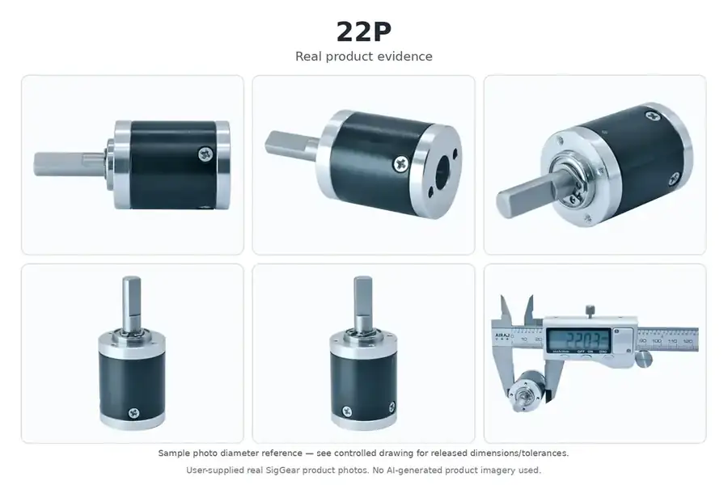

# 22 mm Miniature Precision Planetary Gearhead (22P)

[**Download Datasheet PDF**](../../assets/downloads/22p/22P_Planetary_Gearhead_Datasheet_Rev1.0.pdf){ .md-button .md-button--primary }
[**Download 2D Drawing PDF**](../../assets/downloads/22p/22P_2D_Drawing.pdf){ .md-button }
[**Download Full Assembly STEP**](../../assets/downloads/22p/22P_Full_Assembly.step){ .md-button }
[**Download Simplified 4-Stage STEP · Reference**](../../assets/downloads/22p/22P_Public_Simplified_STEP_v1.0_4-Stage.step){ .md-button }

| Ø Diameter | Reduction ratios | Gearhead body length | Rated allowable torque | Backlash |
| --- | --- | --- | --- | --- |
| **22 mm** | **3.5:1–509.1:1** | **22.6–38.5 mm** | **784.5–2451.7 mN·m** | **≤ 1.5°** |

**More:** [Stage-by-stage ratios](#stage-ratio-and-performance-table) · [Online technical specifications](../../engineering-resources/22p/datasheet.md) · [Mechanical drawing preview](../../engineering-resources/22p/mechanical-interface.md) · [Motor-only datasheets](../../engineering-resources/motors/index.md#22-mm-dc-motors) · [All 12 models](8-42mm-planetary-gear-reducer.md)

{ width="260" loading="lazy" }

## Product Identity

| Item | Description |
| --- | --- |
| Model | 22P |
| Product type | Miniature precision planetary gearhead (planetary gearbox) |
| Nominal outer diameter | 22 mm |
| Number of stages | 1 to 4 |
| Housing material | Steel |
| Gearwheel material | Steel |
| Output bearing | Ball Bearing |

## Key Specifications

| Parameter | Published value |
| --- | ---: |
| Nominal outer diameter | 22 mm |
| Gearhead length range | 22.6–38.5 mm |
| Reduction ratio range | 3.5:1–509.1:1 |
| Rated allowable torque range | 784.5–2451.7 mN·m |
| Maximum momentary torque range | 1569.1–4903.3 mN·m |
| Efficiency range | 66–90% |
| Backlash at no load | ≤ 1.5° |
| Permissible gearhead input speed, continuous operation | 1,000–20,000 rpm |
| Operating temperature | −40 to 120 °C |

Maximum momentary torque is not a continuous working rating.

## Stage, Ratio and Performance Table

| Stages | Gearhead length L | Available reduction ratios | Rated allowable torque | Maximum momentary torque | Efficiency |
| ---: | ---: | --- | ---: | ---: | ---: |
| 1 | 22.6 mm | 3.5 / 4 / 4.75 | 784.5 mN·m | 1569.1 mN·m | 90% |
| 2 | 27.9 mm | 12.25 / 14 / 16 / 16.6 / 19 / 22.6 | 980.7 mN·m | 1961.3 mN·m | 80% |
| 3 | 33.2 mm | 42.9 / 49 / 56 / 58.2 / 64 / 66.5 / 76 / 79 / 90.25 / 107.2 | 1471.0 mN·m | 2942.0 mN·m | 73% |
| 4 | 38.5 mm | 150.1 / 171.5 / 196 / 203.7 / 224 / 232.7 / 256 / 266 / 276.4 / 304 / 315.9 / 361 / 375.1 / 428.7 / 509.1 | 2451.7 mN·m | 4903.3 mN·m | 66% |

## Shaft and Load Limits

| Parameter | Published value |
| --- | ---: |
| Radial load, measured 10 mm from flange | ≤ 1.6 kgf |
| Shaft axial load | ≤ 0.5 kgf |
| Radial shaft play | ≤ 0.04 mm |
| Thrust shaft play | ≤ 0.2 mm |

## Motor Compatibility

The adapted-motor sheet identifies DC motors with a nominal voltage of **3–36 VDC** and rated power **below 25 W**. If a motor cannot meet the gearhead installation requirements, motor matching must be negotiated separately.

These are adapted-motor conditions, not an electrical voltage or power rating for the mechanical gearhead itself. Confirm the motor shaft, mounting interface, input speed, duty cycle and operating point for the selected gearhead ratio.

## Dimensions and Interface

Published dimensional references identify a 22 mm body, a 20 mm output-shaft extension and stage-dependent gearhead body lengths of 22.6, 27.9, 33.2 and 38.5 mm. Review the [22P Mechanical Interface](../../engineering-resources/22p/mechanical-interface.md) and request the applicable configuration-controlled drawing to confirm the output shaft, mounting, motor interface and tolerances.

## CAD Notes

The **Full Assembly STEP** is the published original Creo assembly. The **Simplified STEP** is a separate 4-stage reference for preliminary mechanical packaging. The [22P 2D outline drawing](../../assets/downloads/22p/22P_2D_Drawing.pdf) is the original **SG01PD22** interface reference. The body length **L ±0.3 mm** is configuration-dependent; confirm stage, ratio and motor mating dimensions before production.

[Back to the 8–42 mm product catalogue](8-42mm-planetary-gear-reducer.md)

**Potential OEM applications** *(suitability requires engineering review)*: [Beverage dispensing](../../applications/food-beverage-coffee-equipment-gear-motors.md) · [Curtains and roller blinds](../../applications/electric-curtain-blind-window-opener-gear-motors.md) · [Pet feeder and litter-box mechanisms](../../applications/smart-pet-feeder-litter-box-planetary-gearheads.md) · [Smart vent drives](../../applications/hvac-smart-vent-damper-gear-motors.md) · [All applications](../../applications/index.md).

**Motor + Gearhead Assembly:** [Motor matching and custom integration](../../custom-engineering/motor-gearbox-integration.md).
