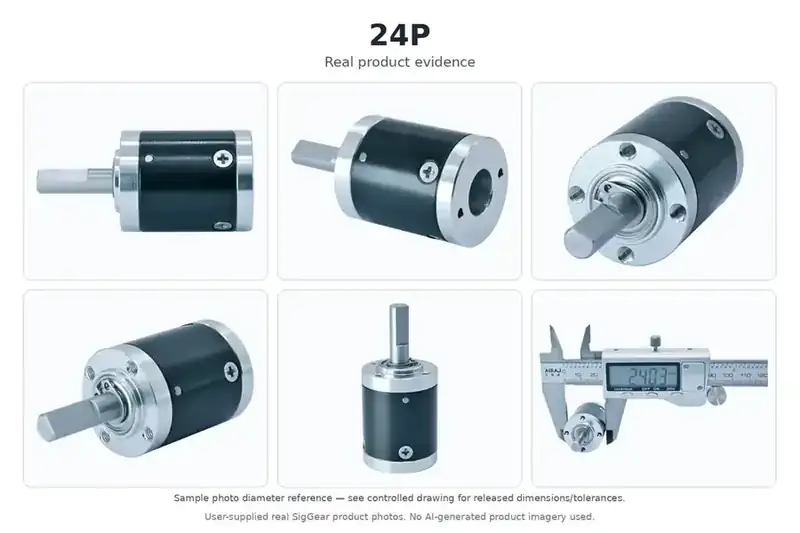

# 24 mm Miniature Precision Planetary Gearhead (24P)

## Product Overview

The SigGear 24P is a 24 mm miniature precision planetary gearhead (planetary gearbox) for compact motorized mechanisms. The published configurations cover one to four stages, with reduction ratios from 3.83:1 to 759.7:1.

## Real Product Evidence

*Real 24P frame-size product photographed from multiple angles. The caliper photo is a visual diameter reference for the photographed sample and does not replace the controlled dimensional drawing or released tolerances for a confirmed configuration.*

**Continuous input-speed range (confirmed 2026-10-15):** 1,000–20,000 rpm for preliminary standard gearbox selection. Speeds outside this range require a custom feasibility review. Motor matching, duty cycle and application conditions must still be confirmed.

**Sizing a 24 mm OEM gearbox?** Check the published ratios, stage-dependent body lengths and rated torque with the SigGear selector. The maximum diameter starts at 24 mm and can be adjusted.

[Open SigGear Planetary Gearbox Selector — 24 mm starting point](../../selection-guides/miniature-planetary-gearbox-selection-guide.md?max_diameter=24#preliminary-ratio-stage-finder){ .md-button }

## Product Identity

| Item | Description |
| --- | --- |
| Model | 24P |
| Product type | Miniature precision planetary gearhead (planetary gearbox) |
| Nominal outer diameter | 24 mm |
| Number of stages | 1 to 4 |
| Housing material | Steel |
| Gearwheel material | Steel |
| Output bearing | Ball bearings |

## Key Specifications

| Parameter | Published value |
| --- | ---: |
| Nominal outer diameter | 24 mm |
| Gearbox length range | 24.6–42.0 mm |
| Reduction ratio range | 3.83:1–759.7:1 |
| Rated allowable torque range | 10.0–30.0 kgf·cm |
| Maximum momentary torque range | 20.0–60.0 kgf·cm |
| Efficiency range | 66–90% |
| Backlash at no load | ≤ 1.2° |
| Permissible gearbox input speed, continuous operation | 1,000–20,000 rpm |
| Operating temperature | −40 to 120 °C |

Torque values are preserved in the source unit, kgf·cm. Maximum momentary torque is not a continuous working rating.

## Stage, Ratio and Performance Table

| Stages | Gearbox length L | Available reduction ratios | Rated allowable torque | Maximum momentary torque | Efficiency |
| ---: | ---: | --- | ---: | ---: | ---: |
| 1 | 24.6 mm | 3.83 / 4.4 / 5.25 | 10.0 kgf·cm | 20.0 kgf·cm | 90% |
| 2 | 30.4 mm | 14.7 / 16.8 / 19.4 / 20.1 / 23 / 27.7 | 15.0 kgf·cm | 30.0 kgf·cm | 80% |
| 3 | 36.2 mm | 56.2 / 64.5 / 74.1 / 77 / 85.2 / 88.5 / 101.6 / 105.6 / 121.3 / 144.7 | 20.0 kgf·cm | 40.0 kgf·cm | 73% |
| 4 | 42.0 mm | 215.2 / 247.2 / 284 / 294.9 / 326.2 / 338.6 / 374.8 / 389.3 / 404.3 / 447.2 / 464.5 / 533.6 / 554.2 / 636.7 / 759.7 | 30.0 kgf·cm | 60.0 kgf·cm | 66% |

## Shaft and Load Limits

| Parameter | Published value |
| --- | ---: |
| Housing material | Steel |
| Gearwheel material | Steel |
| Bearing at output | Ball bearings |
| Radial load, measured 10 mm from flange | ≤ 3.0 kgf |
| Shaft axial load | ≤ 1.0 kgf |
| Radial shaft play | ≤ 0.04 mm |
| Thrust shaft play | ≤ 0.3 mm |
| Backlash at no load | ≤ 1.2° |
| Maximum permissible speed, continuous operation | 1,000–20,000 rpm |
| Operating temperature | −40 to 120 °C |

## Motor Compatibility

The adapted-motor sheet identifies DC motors with a nominal voltage of **3–36 VDC** and power **below 28 W**. If a motor cannot meet the gearbox installation requirements, details need to be negotiated separately.

These are adapted-motor conditions, not an electrical voltage or power rating for the mechanical gearbox itself. Confirm the motor shaft, mounting interface, input speed, duty cycle and operating point for the selected gearbox ratio.

## Dimensions and Interface

The published drawing shows a 24 mm body and stage-dependent gearbox lengths of 24.6, 30.4, 36.2 and 42.0 mm. Use the approved drawing for the complete shaft, mounting, input-interface and tolerance notation.

## Typical Applications

### Potential OEM Applications for the 24P 24 mm Gearhead

For a 24 mm envelope, start with normal running torque and peak obstructions, then check the chosen motor and its mounting interface.

| Example mechanism and application guide | Critical selection checks |
| --- | --- |
| [Automatic pet feeder metering drive](../../applications/smart-pet-feeder-litter-box-planetary-gearheads.md) | Review auger clogging, feed consistency and output support |
| [Compact irrigation or fluid valve](../../applications/pump-valve-fluid-control-gear-motors.md) | Confirm valve breakaway torque, pressure and duty cycle |
| [Small gripper rotary jaw](../../applications/robot-gripper-gear-motors.md) | Calculate jaw force, gearbox ratio and positioning targets |

These are **application ideas for engineering evaluation**, not claims that the 24P has been production-validated in these devices. Final suitability depends on rated torque, ratio and stage count, output-shaft loads, input speed, mounting details and representative device testing.

### 24P Engineering Path: Application → Model → STEP CAD → Inquiry

[Find a Gearhead — Maximum 24 mm Filter](../../selection-guides/miniature-planetary-gearbox-selection-guide.md?max_diameter=24#preliminary-ratio-stage-finder){ .md-button }
[24P Technical Datasheet](../../engineering-resources/24p/datasheet.md){ .md-button }
[24P Mechanical Interface](../../engineering-resources/24p/mechanical-interface.md){ .md-button }

[Download 24P Simplified 4-Stage STEP](../../assets/downloads/24p/24P_Public_Simplified_STEP_v1.0_4-Stage.step){ .md-button .md-button--primary }
[Request 24P Configuration-Matched CAD or Sample](../../request-cad-sample-quote.md?model=24P){ .md-button }

**CAD boundary:** Public simplified STEP shows a **4-stage reference only**. Other ratios, stage counts, motor interfaces and production drawings require an engineering review. The selector's diameter filter is a maximum limit, not confirmation of 24P application suitability.

## Supply Configuration

SigGear can evaluate the 24P as **Gearhead Only** for an existing motor, or review a **Motor + Gearhead Assembly** for the customer's specific application. Motor-to-gearhead interface and final performance remain subject to engineering confirmation.

[Existing Motor — Start 24P Design-In Review](../../request-cad-sample-quote.md?model=24P&path=gearbox_only){ .md-button .md-button--primary }
[Complete Drive — Start 24P Motor + Gearhead Review](../../request-cad-sample-quote.md?model=24P&path=motor_gearbox){ .md-button }

[Not Sure Yet — Open 24P Project Brief](../../request-cad-sample-quote.md?model=24P){ .md-button }

## Selection Information Required

Please provide:

- Required reduction ratio or output speed
- Continuous and momentary output torque
- Motor type, voltage, power, speed and shaft dimensions
- Available gearbox length and mounting interface
- Output-shaft requirements
- Radial and axial loads
- Duty cycle and ambient temperature
- Backlash, noise and service-life targets
- Prototype and annual quantity

Do not transfer the 24P specifications to another frame size or an unlisted stage configuration. Final selection and quotation require confirmation against the approved configuration drawing.

## Engineering Resources

[View 24P Technical Datasheet v1.0](../../engineering-resources/24p/datasheet.md){ .md-button .md-button--primary }
[View 24P Mechanical Interface v1.0](../../engineering-resources/24p/mechanical-interface.md){ .md-button }
[Download Simplified STEP - 4-Stage Reference](../../assets/downloads/24p/24P_Public_Simplified_STEP_v1.0_4-Stage.step){ .md-button .md-button--primary }

The Datasheet consolidates the currently published stage, ratio, torque, efficiency and motor-matching data. The Mechanical Interface summarizes the controlled 2D drawing.

A detailed full-assembly STEP is held as configuration-controlled engineering CAD and is supplied after model / stage / motor-interface review. The raw assembly is not published as a public download because it contains internal planetary transmission geometry.

## TraceParts CAD Discovery

[View 24P 3D CAD on TraceParts (English)](https://www.traceparts.com/en/product/siggear-24p-24-mm-miniature-planetary-gearbox?CatalogPath=TRACEPARTS%3ATP01005004004&Product=27-05769189-121065&PartNumber=24p){ .md-button .md-button--primary }
[Browse SigGear Catalog (Chinese Portal)](https://www.traceparts.cn/zh/search/siggear?CatalogPath=GUANGDONG_1991627740%3AF_SIGGEAR){ .md-button }

The link above opens the **24P product detail page** on TraceParts International, using the exact address provided by the SigGear operator. STEP AP203 generation and download for this model were confirmed on **2026-10-14**. The Chinese catalog link is provided as an alternative browsing route. Public CAD is a **simplified 4-stage reference**; check stage, ratio and interfaces before production design, and request controlled configuration-matched CAD if required.

## Related Planetary Gearhead Resources

[8–42 mm Precision Planetary Gearheads](8-42mm-planetary-gear-reducer.md){ .md-button .md-button--primary }
[Browse All Planetary Gearheads](index.md){ .md-button }
[Request CAD, Sample and Quote](../../request-cad-sample-quote.md){ .md-button }

## Contact SigGear

**Wanrong Wang**

International Sales, SigGear

[wangwanrong@siggear.com](mailto:wangwanrong@siggear.com)
