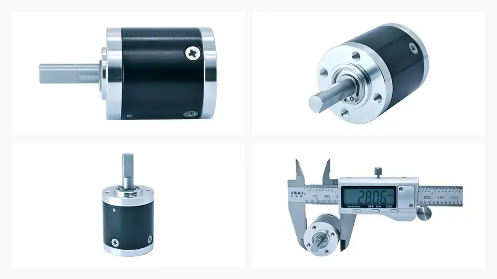

# 28 mm Miniature Precision Planetary Gearhead (28P)

[**Download Datasheet PDF**](../../assets/downloads/28p/28P_Planetary_Gearhead_Datasheet_Rev1.0.pdf){ .md-button .md-button--primary }
[**Download 2D Drawing PDF**](../../assets/downloads/28p/28P_2D_Drawing.pdf){ .md-button }
[**Download Full Assembly STEP**](../../assets/downloads/28p/28P_Full_Assembly.step){ .md-button }
[**Download Simplified 4-Stage STEP · Reference**](../../assets/downloads/28p/28P_Public_Simplified_STEP_v1.0_4-Stage.step){ .md-button }

| Ø Diameter | Reduction ratios | Gearhead body length | Rated allowable torque | Backlash |
| --- | --- | --- | --- | --- |
| **28 mm** | **3.83:1–759.7:1** | **25.6–44.5 mm** | **1961.3–4903.3 mN·m** | **≤ 1.2°** |

**Custom 28P interface or motor fit?** [Match my motor](../../request-cad-sample-quote.md?model=28P&start=existing_motor&path=gearbox_only) · [Review my drawing / STEP](../../request-cad-sample-quote.md?model=28P&start=drawing_cad) · [Review a failing gearbox](../../request-cad-sample-quote.md?model=28P&start=failing_gearbox&path=gearbox_only) · [Prototype → volume](../../request-cad-sample-quote.md?model=28P&start=prototype_to_volume)

**More:** [Stage-by-stage ratios](#stage-ratio-and-performance-table) · [Online technical specifications](../../engineering-resources/28p/datasheet.md) · [Mechanical drawing preview](../../engineering-resources/28p/mechanical-interface.md) · [Motor-only datasheets](../../engineering-resources/motors/index.md#28-mm-dc-motors) · [All 12 models](8-42mm-planetary-gear-reducer.md)

{ width="260" loading="lazy" }

## Product Identity

| Item | Description |
| --- | --- |
| Model | 28P |
| Product type | Miniature precision planetary gearhead (planetary gearbox) |
| Nominal outer diameter | 28 mm |
| Number of stages | 1 to 4 |
| Manufacturing process | Machining |

## Key Specifications

| Parameter | Published value |
| --- | ---: |
| Nominal outer diameter | 28 mm |
| Gearhead length range | 25.6–44.5 mm |
| Reduction ratio range | 3.83:1–759.7:1 |
| Rated allowable torque range | 1961.3–4903.3 mN·m |
| Maximum momentary torque range | 3922.7–9806.6 mN·m |
| Efficiency range | 66–90% |
| Backlash at no load | ≤ 1.2° |
| Permissible gearhead input speed, continuous operation | Motor/configuration dependent; confirm selected operating point |
| Adapted DC motor voltage | 3–36 VDC |
| Adapted DC motor power | below 30 W |

Maximum momentary torque is not a continuous working rating.

## Stage, Ratio and Performance Table

| Stages | Gearhead length L | Available reduction ratios | Rated allowable torque | Maximum momentary torque | Efficiency |
| ---: | ---: | --- | ---: | ---: | ---: |
| 1 | 25.6 mm | 3.83 / 4.4 / 5.25 | 1961.3 mN·m | 3922.7 mN·m | 90% |
| 2 | 31.9 mm | 14.7 / 16.8 / 19.4 / 20.1 / 23 / 27.7 | 2451.7 mN·m | 4903.3 mN·m | 80% |
| 3 | 38.2 mm | 56.2 / 64.5 / 74.1 / 77 / 85.2 / 88.5 / 101.6 / 105.6 / 121.3 / 144.7 | 3432.3 mN·m | 6864.7 mN·m | 73% |
| 4 | 44.5 mm | 215.2 / 247.2 / 284 / 294.9 / 326.2 / 338.8 / 374.8 / 389.3 / 404.3 / 447.2 / 464.5 / 533.6 / 554.2 / 636.7 / 759.7 | 4903.3 mN·m | 9806.6 mN·m | 66% |

## Motor Compatibility

The adapted-motor sheet identifies DC motors with a nominal voltage of **3–36 VDC** and power **below 30 W**. If the motor cannot meet the gearhead installation requirements, the motor and gearhead interface details need to be negotiated separately.

These are adapted-motor conditions, not an electrical voltage or power rating for the mechanical gearhead itself. Confirm the motor shaft, mounting interface, input speed, duty cycle and operating point for the selected gearhead ratio.

## Dimensions and Interface

The published drawing shows a 28 mm body diameter, a 20 mm output shaft reference length and stage-dependent gearhead lengths of 25.6, 31.9, 38.2 and 44.5 mm. Use the approved drawing for shaft geometry, mounting holes, input-interface details and tolerance notation.

## STEP Notes

The **Full Assembly STEP** is the published original Creo assembly. The **Simplified STEP** is a separate 4-stage reference for preliminary mechanical packaging. The [28P 2D outline drawing](../../assets/downloads/28p/28P_2D_Drawing.pdf) is the original **SG01PD28** interface reference. The body length **L ±0.3 mm** is configuration-dependent; confirm stage, ratio and motor mating dimensions before production.

[Back to the 8–42 mm product catalogue](8-42mm-planetary-gear-reducer.md)

**Potential OEM applications** *(suitability requires engineering review)*: [Agricultural metering](../../applications/agriculture-outdoor-equipment-gear-motors.md) · [AGV/AMR auxiliary mechanisms](../../applications/agv-amr-wheel-drive-gearboxes.md) · [All applications](../../applications/index.md).

**Motor + Gearhead Assembly:** [Motor matching and custom integration](../../custom-engineering/motor-gearbox-integration.md).
