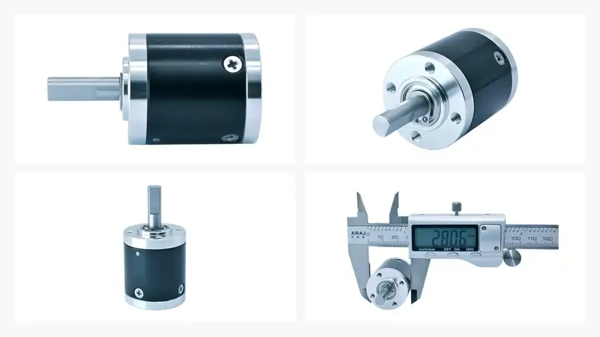

# 28 mm Miniature Planetary Gearbox (28P)

## Product Overview

The SigGear 28P is a 28 mm miniature planetary gearbox for compact motorized mechanisms that require higher torque capacity than smaller miniature planetary frames. Published configurations cover one to four stages, with reduction ratios from 3.83:1 to 759.7:1.

## Real Product Evidence

*Real 28P frame-size product photographed from multiple angles. The caliper photo is a visual diameter reference for the photographed sample and does not replace the controlled dimensional drawing or released tolerances for a confirmed configuration.*

**Continuous input-speed range (confirmed 2026-10-15):** 1,000–20,000 rpm for preliminary standard gearbox selection. Speeds outside this range require a custom feasibility review. Motor matching, duty cycle and application conditions must still be confirmed.

## Product Identity

| Item | Description |
| --- | --- |
| Model | 28P |
| Product type | Miniature planetary gearbox |
| Nominal outer diameter | 28 mm |
| Number of stages | 1 to 4 |
| Manufacturing process | Machining |

## Key Specifications

| Parameter | Published value |
| --- | ---: |
| Nominal outer diameter | 28 mm |
| Gearbox length range | 25.6–44.5 mm |
| Reduction ratio range | 3.83:1–759.7:1 |
| Rated allowable torque range | 20.0–50.0 kgf·cm |
| Maximum momentary torque range | 40.0–100.0 kgf·cm |
| Efficiency range | 66–90% |
| Backlash at no load | ≤ 1.2° |
| Permissible gearbox input speed, continuous operation | 1,000–20,000 rpm |
| Adapted DC motor voltage | 3–36 VDC |
| Adapted DC motor power | below 30 W |

Torque values are preserved in the source unit, kgf·cm. Maximum momentary torque is not a continuous working rating.

## Stage, Ratio and Performance Table

| Stages | Gearbox length L | Available reduction ratios | Rated allowable torque | Maximum momentary torque | Efficiency |
| ---: | ---: | --- | ---: | ---: | ---: |
| 1 | 25.6 mm | 3.83 / 4.4 / 5.25 | 20.0 kgf·cm | 40.0 kgf·cm | 90% |
| 2 | 31.9 mm | 14.7 / 16.8 / 19.4 / 20.1 / 23 / 27.7 | 25.0 kgf·cm | 50.0 kgf·cm | 80% |
| 3 | 38.2 mm | 56.2 / 64.5 / 74.1 / 77 / 85.2 / 88.5 / 101.6 / 105.6 / 121.3 / 144.7 | 35.0 kgf·cm | 70.0 kgf·cm | 73% |
| 4 | 44.5 mm | 215.2 / 247.2 / 284 / 294.9 / 326.2 / 338.8 / 374.8 / 389.3 / 404.3 / 447.2 / 464.5 / 533.6 / 554.2 / 636.7 / 759.7 | 50.0 kgf·cm | 100.0 kgf·cm | 66% |

## Motor Compatibility

The adapted-motor sheet identifies DC motors with a nominal voltage of **3–36 VDC** and power **below 30 W**. If the motor cannot meet the gearbox installation requirements, the motor and gearbox interface details need to be negotiated separately.

These are adapted-motor conditions, not an electrical voltage or power rating for the mechanical gearbox itself. Confirm the motor shaft, mounting interface, input speed, duty cycle and operating point for the selected gearbox ratio.

## Dimensions and Interface

The published drawing shows a 28 mm body diameter, a 20 mm output shaft reference length and stage-dependent gearbox lengths of 25.6, 31.9, 38.2 and 44.5 mm. Use the approved drawing for shaft geometry, mounting holes, input-interface details and tolerance notation.

## Typical Applications

- Compact robotic joints and grippers
- Medical and laboratory automation mechanisms
- Precision instruments and optical adjustment mechanisms
- Mini pumps and valve drives
- Smart hardware and compact actuators

Application suitability depends on the selected ratio, motor, load direction, duty cycle, installation and required service life.

## Supply Configuration

SigGear can supply the planetary gearbox as a gearbox-only unit, or evaluate and match a motor based on the customer's specific application requirements to provide a complete motor + gearbox assembly.

[Existing Motor — Start 28P Design-In Review](../../request-cad-sample-quote.md?model=28P&path=gearbox_only){ .md-button .md-button--primary }
[Complete Drive — Start 28P Motor + Gearbox Review](../../request-cad-sample-quote.md?model=28P&path=motor_gearbox){ .md-button }

[Not Sure Yet — Open 28P Project Brief](../../request-cad-sample-quote.md?model=28P){ .md-button }

## Selection Information Required

Please provide:

- Required reduction ratio or output speed
- Continuous and momentary output torque
- Motor type, voltage, power, speed and shaft dimensions
- Available gearbox length and mounting interface
- Output-shaft requirements
- Radial and axial loads
- Duty cycle and ambient temperature
- Backlash, noise and service-life targets
- Prototype and annual quantity

Do not transfer the 28P specifications to another frame size or an unlisted stage configuration. Final selection and quotation require confirmation against the approved configuration drawing.

## Engineering Resources

[View 28P Technical Datasheet v1.0](../../engineering-resources/28p/datasheet.md){ .md-button .md-button--primary }
[View 28P Mechanical Interface v1.0](../../engineering-resources/28p/mechanical-interface.md){ .md-button }
[Download Simplified STEP - 4-Stage Reference](../../assets/downloads/28p/28P_Public_Simplified_STEP_v1.0_4-Stage.step){ .md-button .md-button--primary }

The Datasheet consolidates the currently published stage, ratio, torque, efficiency and motor-matching data. The Mechanical Interface summarizes the controlled 2D drawing.

A detailed full-assembly STEP is held as configuration-controlled engineering CAD and is supplied after model / stage / motor-interface review. The raw assembly is not published as a public download because it contains internal planetary transmission geometry.

## TraceParts CAD Discovery

[View 28P 3D CAD on TraceParts (English)](https://www.traceparts.com/en/product/siggear-28p-28-mm-miniature-planetary-gearbox?CatalogPath=TRACEPARTS%3ATP01005004004&Product=27-05769189-121063&PartNumber=28p){ .md-button .md-button--primary }
[Browse SigGear Catalog (Chinese Portal)](https://www.traceparts.cn/zh/search/siggear?CatalogPath=GUANGDONG_1991627740%3AF_SIGGEAR){ .md-button }

The link above opens the **28P product detail page** on TraceParts International, using the exact address provided by the SigGear operator. STEP AP203 generation and download for this model were confirmed on **2026-10-14**. The Chinese catalog link is provided as an alternative browsing route. Public CAD is a **simplified 4-stage reference**; check stage, ratio and interfaces before production design, and request controlled configuration-matched CAD if required.

## Related Planetary Gearbox Resources

[8–42 mm Planetary Gearbox Series](8-42mm-planetary-gear-reducer.md){ .md-button .md-button--primary }
[Browse All Planetary Gearboxes](index.md){ .md-button }
[Request CAD, Sample and Quote](../../request-cad-sample-quote.md){ .md-button }

## Contact SigGear

**Wanrong Wang**

International Sales, SigGear

[wangwanrong@siggear.com](mailto:wangwanrong@siggear.com)
