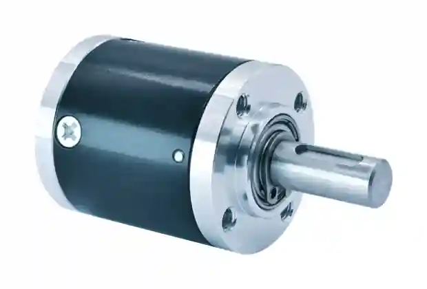

# 32 mm Miniature Precision Planetary Gearhead (32P)

[**Download Datasheet PDF**](../../assets/downloads/32p/32P_Planetary_Gearhead_Datasheet_Rev1.0.pdf){ .md-button .md-button--primary }
[**Download 2D Drawing PDF**](../../assets/downloads/32p/32P_2D_Drawing.pdf){ .md-button }
[**Download Full Assembly STEP**](../../assets/downloads/32p/32P_Full_Assembly.step){ .md-button }

| Ø Diameter | Reduction ratios | Gearhead body length | Rated allowable torque | Backlash |
| --- | --- | --- | --- | --- |
| **32 mm** | **3.5:1–509.1:1** | **28.05–52.95 mm** | **3432.3–7845.3 mN·m** | **≤ 1.2°** |

**More:** [Stage-by-stage ratios](#stage-ratio-and-performance-table) · [Online technical specifications](../../engineering-resources/32p/datasheet.md) · [Simplified 4-stage STEP](../../assets/downloads/32p/32P_Public_Simplified_STEP_v1.0_4-Stage.step) · [Mechanical drawing preview](../../engineering-resources/32p/mechanical-interface.md) · [Motor-only datasheets](../../engineering-resources/motors/index.md#32-mm-dc-motors) · [All 12 models](8-42mm-planetary-gear-reducer.md)

{ width="260" loading="lazy" }

## Product Identity

| Item | Description |
| --- | --- |
| Model | 32P |
| Product type | Miniature precision planetary gearhead (planetary gearbox) |
| Nominal outer diameter | 32 mm |
| Number of stages | 1 to 4 |
| Manufacturing process | Machining |

## Key Specifications

| Parameter | Published value |
| --- | ---: |
| Nominal outer diameter | 32 mm |
| Gearhead length range | 28.05–52.95 mm |
| Reduction ratio range | 3.5:1–509.1:1 |
| Rated allowable torque range | 3432.3–7845.3 mN·m |
| Maximum momentary torque range | 6864.7–15690.6 mN·m |
| Efficiency range | 66–90% |
| Backlash at no load | ≤ 1.2° |
| Permissible gearhead input speed, continuous operation | 1,000–20,000 rpm |
| Adapted DC motor voltage | 3–36 VDC |
| Adapted DC motor power | below 100 W |
| Housing material | Steel |
| Gear material | Steel |
| Output bearing | Ball Bearing |
| Radial load, 10 mm from flange | <= 8.0 kgf |
| Shaft axial load | <= 3.5 kgf |
| Radial play of shaft | <= 0.04 mm |
| Thrust play of shaft | <= 0.3 mm |
| Operating temperature range | -40 to 120 C |

Maximum momentary torque is not a continuous working rating.

The current public specification uses **≤ 1.2°** as the backlash-at-no-load value.

## Stage, Ratio and Performance Table

| Stages | Gearhead length L | Available reduction ratios | Rated allowable torque | Maximum momentary torque | Efficiency |
| ---: | ---: | --- | ---: | ---: | ---: |
| 1 | 28.05 mm | 3.5 / 4 / 4.75 | 3432.3 mN·m | 6864.7 mN·m | 90% |
| 2 | 36.35 mm | 12.2 / 14 / 16 / 16.6 / 19 / 22.6 | 4903.3 mN·m | 9806.6 mN·m | 80% |
| 3 | 44.65 mm | 42.9 / 49 / 56 / 58.2 / 64 / 66.5 / 76 / 79 / 90.2 / 107.2 | 6374.3 mN·m | 12748.6 mN·m | 73% |
| 4 | 52.95 mm | 150.1 / 171.5 / 196 / 203.7 / 224 / 232.7 / 256 / 266 / 276.4 / 304 / 315.9 / 361 / 375.1 / 428.7 / 509.1 | 7845.3 mN·m | 15690.6 mN·m | 66% |

## Motor Compatibility

The adapted-motor sheet identifies DC motors with a nominal voltage of **3–36 VDC** and power **below 100 W**. If the motor cannot meet the gearhead installation requirements, the motor and gearhead interface details need to be negotiated separately.

These are adapted-motor conditions, not an electrical voltage or power rating for the mechanical gearhead itself. Confirm the motor shaft, mounting interface, input speed, duty cycle and operating point for the selected gearhead ratio.

## Dimensions and Interface

The published drawing shows a 32 mm body diameter and stage-dependent gearhead lengths of 28.05, 36.35, 44.65 and 52.95 mm.

The current public CAD is a **4-stage reference** corresponding to the 52.95 mm gearhead-body length. It must not be treated as a universal 1-4 stage CAD model.

Publicly released interface information includes:

- Output side: 4 x M3 threaded holes, depth 4.5 mm
- Output mounting-hole center radius: 9.8 mm
- Output-side reference diameter: 26.0 +/- 0.1 mm
- Nominal output shaft diameter: 8 mm
- Output shaft extension: 21.6 mm (+0.1 / -0.3 mm)
- Keyway width shown on the controlled drawing: 3.0 mm
- Keyway length shown on the controlled drawing: 12.0 mm
- Input side: 2 x dia. 3.1 mm mounting holes
- Opposed input mounting-hole center spacing: 22.0 +/- 0.1 mm
- Central input opening: dia. 13.0 +0.05 / 0 mm

Use the controlled drawing for final tolerances, keyseat definition and production release.

## CAD Notes

The **Full Assembly STEP** is the published original Creo assembly. The **Simplified STEP** is a separate 4-stage reference for preliminary mechanical packaging. The [32P 2D outline drawing](../../assets/downloads/32p/32P_2D_Drawing.pdf) is the original **SG01PD32** interface reference. The body length **L ±0.3 mm** is configuration-dependent; confirm stage, ratio and motor mating dimensions before production.

[Back to the 8–42 mm product catalogue](8-42mm-planetary-gear-reducer.md)
