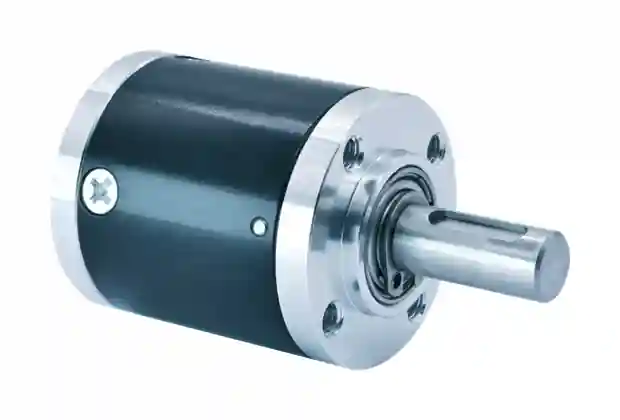

# 32 mm Miniature Planetary Gearbox (32P)

## Product Overview

The SigGear 32P is a 32 mm miniature planetary gearbox for compact motorized mechanisms requiring higher torque capacity in a still-compact planetary gearbox package. Published configurations cover one to four stages, with reduction ratios from 3.5:1 to 509.1:1.

## Real Product Photography

*Photograph of the 32P gearbox provided by SigGear. For mounting geometry, controlled tolerances and stage-specific lengths, refer to the approved drawing and [32P Design-In Pack](../../engineering-resources/32p/design-in-pack.md).*

## Engineering Selection and CAD Access

For an OEM design requiring a **32 mm miniature planetary gearbox / planetary gearhead**, use the published 32P stage/ratio table together with the [32P Design-In Pack](../../engineering-resources/32p/design-in-pack.md). The published gearbox body length ranges from **28.05 to 52.95 mm** depending on the stage configuration. The dedicated motor-integration reference helps review an existing motor's shaft and mounting interface; it does not establish automatic compatibility with every motor.

**Design-In files:** [32P Technical Datasheet](../../engineering-resources/32p/datasheet.md) · [32P Motor Integration Guide](../../engineering-resources/32p/motor-integration.md)

[Download 32P Public Simplified STEP — 4-Stage Reference](../../assets/downloads/32p/32P_Public_Simplified_STEP_v1.0_4-Stage.step){ .md-button .md-button--primary }
[Request 32P Configuration Review](../../request-cad-sample-quote.md){ .md-button }

The downloadable STEP represents the **4-stage reference configuration only** and is intended for preliminary mechanical packaging. It is **not** a dimensionally interchangeable 1-, 2- or 3-stage model. Request configuration-matched CAD and a controlled drawing before design freeze.

**Continuous input-speed range (confirmed 2026-10-15):** 1,000–20,000 rpm for preliminary standard gearbox selection. Speeds outside this range require a custom feasibility review. Motor matching, duty cycle and application conditions must still be confirmed.

## Product Identity

| Item | Description |
| --- | --- |
| Model | 32P |
| Product type | Miniature planetary gearbox |
| Nominal outer diameter | 32 mm |
| Number of stages | 1 to 4 |
| Manufacturing process | Machining |

## Key Specifications

| Parameter | Published value |
| --- | ---: |
| Nominal outer diameter | 32 mm |
| Gearbox length range | 28.05–52.95 mm |
| Reduction ratio range | 3.5:1–509.1:1 |
| Rated allowable torque range | 35.0–80.0 kgf·cm |
| Maximum momentary torque range | 70.0–160.0 kgf·cm |
| Efficiency range | 66–90% |
| Backlash at no load | ≤ 1.2° |
| Permissible gearbox input speed, continuous operation | 1,000–20,000 rpm |
| Adapted DC motor voltage | 3–36 VDC |
| Adapted DC motor power | below 100 W |
| Housing material | Steel |
| Gear material | Steel |
| Output bearing | Ball bearings |
| Radial load, 10 mm from flange | <= 8.0 kgf |
| Shaft axial load | <= 3.5 kgf |
| Radial play of shaft | <= 0.04 mm |
| Thrust play of shaft | <= 0.3 mm |
| Operating temperature range | -40 to 120 C |

Torque values are preserved in the source unit, kgf·cm. Maximum momentary torque is not a continuous working rating.

The current public specification uses **≤ 1.2°** as the backlash-at-no-load value.

## Stage, Ratio and Performance Table

| Stages | Gearbox length L | Available reduction ratios | Rated allowable torque | Maximum momentary torque | Efficiency |
| ---: | ---: | --- | ---: | ---: | ---: |
| 1 | 28.05 mm | 3.5 / 4 / 4.75 | 35.0 kgf·cm | 70.0 kgf·cm | 90% |
| 2 | 36.35 mm | 12.2 / 14 / 16 / 16.6 / 19 / 22.6 | 50.0 kgf·cm | 100.0 kgf·cm | 80% |
| 3 | 44.65 mm | 42.9 / 49 / 56 / 58.2 / 64 / 66.5 / 76 / 79 / 90.2 / 107.2 | 65.0 kgf·cm | 130.0 kgf·cm | 73% |
| 4 | 52.95 mm | 150.1 / 171.5 / 196 / 203.7 / 224 / 232.7 / 256 / 266 / 276.4 / 304 / 315.9 / 361 / 375.1 / 428.7 / 509.1 | 80.0 kgf·cm | 160.0 kgf·cm | 66% |

## Motor Compatibility

The adapted-motor sheet identifies DC motors with a nominal voltage of **3–36 VDC** and power **below 100 W**. If the motor cannot meet the gearbox installation requirements, the motor and gearbox interface details need to be negotiated separately.

These are adapted-motor conditions, not an electrical voltage or power rating for the mechanical gearbox itself. Confirm the motor shaft, mounting interface, input speed, duty cycle and operating point for the selected gearbox ratio.

## Dimensions and Interface

The published drawing shows a 32 mm body diameter and stage-dependent gearbox lengths of 28.05, 36.35, 44.65 and 52.95 mm.

The current public CAD is a **4-stage reference** corresponding to the 52.95 mm gearbox-body length. It must not be treated as a universal 1-4 stage CAD model.

Publicly released interface information includes:

- Output side: 4 x M3 threaded holes, depth 4.5 mm
- Output mounting-hole center radius: 9.8 mm
- Output-side reference diameter: 26.0 +/- 0.1 mm
- Nominal output shaft diameter: 8 mm
- Output shaft extension: 21.6 mm (+0.1 / -0.3 mm)
- Keyway width shown on the controlled drawing: 3.0 mm
- Keyway length shown on the controlled drawing: 12.0 mm
- Input side: 2 x dia. 3.1 mm mounting holes
- Opposed input mounting-hole center spacing: 22.0 +/- 0.1 mm
- Central input opening: dia. 13.0 +0.05 / 0 mm

Use the controlled drawing for final tolerances, keyseat definition and production release.

## Typical Applications

- Compact robotic joints and grippers
- Medical and laboratory automation mechanisms
- Precision instruments and optical adjustment mechanisms
- Mini pumps and valve drives
- Smart hardware and compact actuators
- Servo and automation modules

Application suitability depends on the selected ratio, motor, load direction, duty cycle, installation and required service life.

## Supply Configuration

SigGear can supply the **32P 32 mm planetary gearbox as a gearbox-only unit**, subject to the selected ratio and mechanical interface. This route is relevant if you already have a motor and need to evaluate shaft, pilot, mounting-pattern and input-speed compatibility.

If you need a **motor + planetary gearbox assembly**, SigGear can evaluate a matching motor against the required output speed, continuous load, voltage, available space and duty cycle. Compatibility and final performance must be confirmed for the exact configuration.

[Start a 32P OEM Gearbox Inquiry](../../request-cad-sample-quote.md){ .md-button .md-button--primary }

[Existing Motor — Start 32P Design-In Review](../../request-cad-sample-quote.md?model=32P&path=gearbox_only){ .md-button .md-button--primary }
[Complete Drive — Start 32P Motor + Gearbox Review](../../request-cad-sample-quote.md?model=32P&path=motor_gearbox){ .md-button }

[Not Sure Yet — Open 32P Project Brief](../../request-cad-sample-quote.md?model=32P){ .md-button }

## Selection Information Required

Please provide:

- Required reduction ratio or output speed
- Continuous and momentary output torque
- Motor type, voltage, power, speed and shaft dimensions
- Available gearbox length and mounting interface
- Output-shaft requirements
- Radial and axial loads
- Duty cycle and ambient temperature
- Backlash, noise and service-life targets
- Prototype and annual quantity

Do not transfer the 32P specifications to another frame size or an unlisted stage configuration. Final selection and quotation require confirmation against the approved configuration drawing.

## Engineering Resources

The following **32P v1.0 public engineering resources** are approved for engineering evaluation and early mechanical design-in:

[Open 32P Public CAD Design-In Pack](../../engineering-resources/32p/design-in-pack.md){ .md-button .md-button--primary }
[View Technical Datasheet v1.0](../../engineering-resources/32p/datasheet.md){ .md-button }
[Download Simplified STEP - 4-Stage Reference](../../assets/downloads/32p/32P_Public_Simplified_STEP_v1.0_4-Stage.step){ .md-button }
[View Mechanical Interface v1.0](../../engineering-resources/32p/mechanical-interface.md){ .md-button }
[View Motor Integration Guide](../../engineering-resources/32p/motor-integration.md){ .md-button }

The public STEP is a simplified external-interface model. It retains the information normally required for packaging, mounting and early design-in while omitting the internal planetary gear train, bearings, carrier details and proprietary assembly construction.

For 1-, 2- or 3-stage CAD, or for the controlled production drawing, contact SigGear with the selected ratio and motor interface.

### Evaluation and Design-In

[Sample Validation Workflow](../../engineering-center/sample-validation-workflow.md){ .md-button .md-button--primary }
[Design-In Checklist](../../engineering-center/design-in-checklist.md){ .md-button }

## TraceParts CAD Discovery

[View 32P 3D CAD on TraceParts (English)](https://www.traceparts.com/en/product/siggear-32p-32-mm-miniature-planetary-gearbox?CatalogPath=TRACEPARTS%3ATP01005004004&Product=27-05769189-121066&PartNumber=32p){ .md-button .md-button--primary }
[Browse SigGear Catalog (Chinese Portal)](https://www.traceparts.cn/zh/search/siggear?CatalogPath=GUANGDONG_1991627740%3AF_SIGGEAR){ .md-button }

The link above opens the **32P product detail page** on TraceParts International, using the exact address provided by the SigGear operator. STEP AP203 generation and download for this model were confirmed on **2026-10-14**. The Chinese catalog link is provided as an alternative browsing route. Public CAD is a **simplified 4-stage reference**; check stage, ratio and interfaces before production design, and request controlled configuration-matched CAD if required.

## Related Planetary Gearbox Resources

**Comparing miniature and compact frame sizes?** Review the [28P 28 mm Miniature Planetary Gearbox](28p-planetary-gearbox.md) or [36P 36 mm Compact Planetary Gearbox](36p-planetary-gearbox.md) alongside this 32P Design-In Pack. Stage length, rated load and motor-side mounting must be evaluated separately for each frame.

[Custom Planetary Gearbox Engineering](../../custom-engineering/custom-planetary-gearbox.md){ .md-button .md-button--primary }
[8–42 mm Planetary Gearbox Series](8-42mm-planetary-gear-reducer.md){ .md-button }
[Browse All Planetary Gearboxes](index.md){ .md-button }
[Request CAD, Sample and Quote](../../request-cad-sample-quote.md){ .md-button }

## Contact SigGear

**Wanrong Wang**

International Sales, SigGear

[wangwanrong@siggear.com](mailto:wangwanrong@siggear.com)
