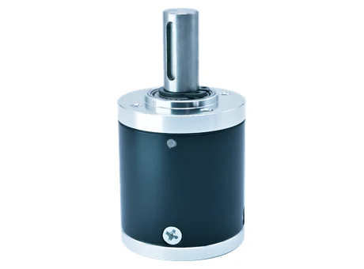

# 36 mm Compact Precision Planetary Gearhead (36P)

## Product Overview

The SigGear 36P is a 36 mm compact precision planetary gearhead (planetary gearbox) for compact motorized mechanisms requiring higher torque capacity while retaining a compact cylindrical planetary gearbox format. Published configurations cover one to four stages, with reduction ratios from 3.66:1 to 625:1.

## Real Product Evidence

{ width="460" height="340" loading="eager" }

*Actual SigGear 36P sample photographed with the output shaft upright and the complete lower housing visible. The photograph is a visual reference only; verify the selected configuration against its confirmed mechanical drawing and tolerances.*

[Open the updated 36P product photo (JPG)](../../assets/images/products/planetary-gearboxes/36p/36p-product-photo-20261014-v2.jpg)

**Continuous input-speed range (confirmed 2026-10-15):** 1,000–20,000 rpm for preliminary standard gearbox selection. Speeds outside this range require a custom feasibility review. Motor matching, duty cycle and application conditions must still be confirmed.

**Sizing a 36 mm OEM gearbox?** Check the published ratios, stage-dependent body lengths and rated torque with the SigGear selector. The maximum diameter starts at 36 mm and can be adjusted.

[Open SigGear Planetary Gearbox Selector — 36 mm starting point](../../selection-guides/miniature-planetary-gearbox-selection-guide.md?max_diameter=36#preliminary-ratio-stage-finder){ .md-button }

## Product Identity

| Item | Description |
| --- | --- |
| Model | 36P |
| Product type | Compact precision planetary gearhead (planetary gearbox) |
| Nominal outer diameter | 36 mm |
| Number of stages | 1 to 4 |
| Housing material | Steel |
| Gear material | Steel |
| Output bearing | Ball bearings |
| Manufacturing process | Machining |

## Key Specifications

| Parameter | Published value |
| --- | ---: |
| Nominal outer diameter | 36 mm |
| Gearbox length range | 30.6–61.5 mm |
| Reduction ratio range | 3.66:1–625:1 |
| Rated allowable torque range | 40.0–100.0 kgf·cm |
| Maximum momentary torque range | 80.0–200.0 kgf·cm |
| Efficiency range | 66–90% |
| Backlash at no load | ≤ 1.2° |
| Permissible gearbox input speed, continuous operation | 1,000–20,000 rpm |
| Operating temperature | −40 to 120 °C |
| Adapted DC motor voltage | 3–48 VDC |
| Adapted DC motor power | below 150 W |

Torque values are preserved in the source unit, kgf·cm. Maximum momentary torque is not a continuous working rating.

## Stage, Ratio and Performance Table

| Stages | Gearbox length L | Available reduction ratios | Rated allowable torque | Maximum momentary torque | Efficiency |
| ---: | ---: | --- | ---: | ---: | ---: |
| 1 | 30.6 mm | 3.66 / 4.2 / 5.0 | 40.0 kgf·cm | 80.0 kgf·cm | 90% |
| 2 | 40.9 mm | 13.4 / 15.4 / 17.6 / 18.3 / 21 / 25 | 60.0 kgf·cm | 120.0 kgf·cm | 80% |
| 3 | 51.2 mm | 49 / 56.3 / 64.6 / 67 / 74.1 / 76.9 / 88.2 / 91.5 / 105 / 125 | 80.0 kgf·cm | 160.0 kgf·cm | 73% |
| 4 | 61.5 mm | 179.4 / 205.9 / 236.3 / 245.1 / 271.2 / 281.3 / 311.2 / 322.8 / 334.9 / 370.5 / 384.3 / 441 / 457.5 / 525 / 625 | 100.0 kgf·cm | 200.0 kgf·cm | 66% |

## Shaft, Load and Operating Limits

| Parameter | Published value |
| --- | ---: |
| Housing material | Steel |
| Gear material | Steel |
| Bearing at output | Ball bearings |
| Radial load, measured 10 mm from flange | ≤ 10.0 kgf |
| Shaft axial load | ≤ 6.0 kgf |
| Radial shaft play | ≤ 0.04 mm |
| Thrust shaft play | ≤ 0.3 mm |
| Backlash at no load | ≤ 1.2° |
| Maximum permissible speed, continuous operation | 1,000–20,000 rpm |
| Operating temperature | −40 to 120 °C |

## Motor Compatibility

The adapted-motor sheet identifies DC motors with a nominal voltage of **3–48 VDC** and power **below 150 W**. If the motor cannot meet the gearbox installation requirements, the motor and gearbox interface details need to be negotiated separately.

These are adapted-motor conditions, not an electrical voltage or power rating for the mechanical gearbox itself. Confirm the motor shaft, mounting interface, input speed, duty cycle and operating point for the selected gearbox ratio.

## Dimensions and Interface

The published drawing shows a 36 mm body diameter and stage-dependent gearbox lengths of 30.6, 40.9, 51.2 and 61.5 mm. Use the approved drawing for shaft geometry, mounting holes, input-interface details and tolerance notation.

## Typical Applications

### Potential OEM Applications for the 36P 36 mm Gearhead

The 36P begins the published Compact size class. Compare continuous output torque and bearing load before considering its use in high-load mechanisms.

| Example mechanism and application guide | Critical selection checks |
| --- | --- |
| [Battery-powered garden pruner](../../applications/electric-pruning-shears-planetary-gearbox.md) | Check cutting peaks, battery motor speed and shaft loading |
| [Automatic litter-box rotation mechanism](../../applications/smart-pet-feeder-litter-box-planetary-gearheads.md) | Assess unbalanced drum load, external bearings and jam detection |
| [Compact automation fixture or indexer](../../applications/industrial-automation-servo-planetary-gearboxes.md) | Define torque profile, repeatability and duty cycle |

These are **application ideas for engineering evaluation**, not claims that the 36P has been production-validated in these devices. Final suitability depends on rated torque, ratio and stage count, output-shaft loads, input speed, mounting details and representative device testing.

### 36P Engineering Path: Application → Model → STEP CAD → Inquiry

[Find a Gearhead — Maximum 36 mm Filter](../../selection-guides/miniature-planetary-gearbox-selection-guide.md?max_diameter=36#preliminary-ratio-stage-finder){ .md-button }
[36P Technical Datasheet](../../engineering-resources/36p/datasheet.md){ .md-button }
[36P Mechanical Interface](../../engineering-resources/36p/mechanical-interface.md){ .md-button }

[Download 36P Simplified 4-Stage STEP](../../assets/downloads/36p/36P_Public_Simplified_STEP_v1.0_4-Stage.step){ .md-button .md-button--primary }
[Request 36P Configuration-Matched CAD or Sample](../../request-cad-sample-quote.md?model=36P){ .md-button }

**CAD boundary:** Public simplified STEP shows a **4-stage reference only**. Other ratios, stage counts, motor interfaces and production drawings require an engineering review. The selector's diameter filter is a maximum limit, not confirmation of 36P application suitability.

## Supply Configuration

SigGear can evaluate the 36P as **Gearhead Only** for an existing motor, or review a **Motor + Gearhead Assembly** for the customer's specific application. Motor-to-gearhead interface and final performance remain subject to engineering confirmation.

[Existing Motor — Start 36P Design-In Review](../../request-cad-sample-quote.md?model=36P&path=gearbox_only){ .md-button .md-button--primary }
[Complete Drive — Start 36P Motor + Gearhead Review](../../request-cad-sample-quote.md?model=36P&path=motor_gearbox){ .md-button }

[Not Sure Yet — Open 36P Project Brief](../../request-cad-sample-quote.md?model=36P){ .md-button }

## Selection Information Required

Please provide:

- Required reduction ratio or output speed
- Continuous and momentary output torque
- Motor type, voltage, power, speed and shaft dimensions
- Available gearbox length and mounting interface
- Output-shaft requirements
- Radial and axial loads
- Duty cycle and ambient temperature
- Backlash, noise and service-life targets
- Prototype and annual quantity

Do not transfer the 36P specifications to another frame size or an unlisted stage configuration. Final selection and quotation require confirmation against the approved configuration drawing.

## Engineering Resources

[View 36P Technical Datasheet v1.0](../../engineering-resources/36p/datasheet.md){ .md-button .md-button--primary }
[View 36P Mechanical Interface v1.0](../../engineering-resources/36p/mechanical-interface.md){ .md-button }
[Download Simplified STEP - 4-Stage Reference](../../assets/downloads/36p/36P_Public_Simplified_STEP_v1.0_4-Stage.step){ .md-button .md-button--primary }

The Datasheet consolidates the currently published stage, ratio, torque, efficiency and motor-matching data. The Mechanical Interface summarizes the controlled 2D drawing.

A detailed full-assembly STEP is held as configuration-controlled engineering CAD and is supplied after model / stage / motor-interface review. The raw assembly is not published as a public download because it contains internal planetary transmission geometry.

## TraceParts CAD Discovery

[View 36P 3D CAD on TraceParts (English)](https://www.traceparts.com/en/product/siggear-36p-36-mm-miniature-planetary-gearbox?CatalogPath=TRACEPARTS%3ATP01005004004&Product=27-05769189-121067&PartNumber=36p){ .md-button .md-button--primary }
[Browse SigGear Catalog (Chinese Portal)](https://www.traceparts.cn/zh/search/siggear?CatalogPath=GUANGDONG_1991627740%3AF_SIGGEAR){ .md-button }

The link above opens the **36P product detail page** on TraceParts International, using the exact address provided by the SigGear operator. STEP AP203 generation and download for this model were confirmed on **2026-10-14**. The Chinese catalog link is provided as an alternative browsing route. Public CAD is a **simplified 4-stage reference**; check stage, ratio and interfaces before production design, and request controlled configuration-matched CAD if required.

## Related Planetary Gearhead Resources

[8–42 mm Precision Planetary Gearheads](8-42mm-planetary-gear-reducer.md){ .md-button .md-button--primary }
[Browse All Planetary Gearheads](index.md){ .md-button }
[Request CAD, Sample and Quote](../../request-cad-sample-quote.md){ .md-button }

## Contact SigGear

**Wanrong Wang**

International Sales, SigGear

[wangwanrong@siggear.com](mailto:wangwanrong@siggear.com)
