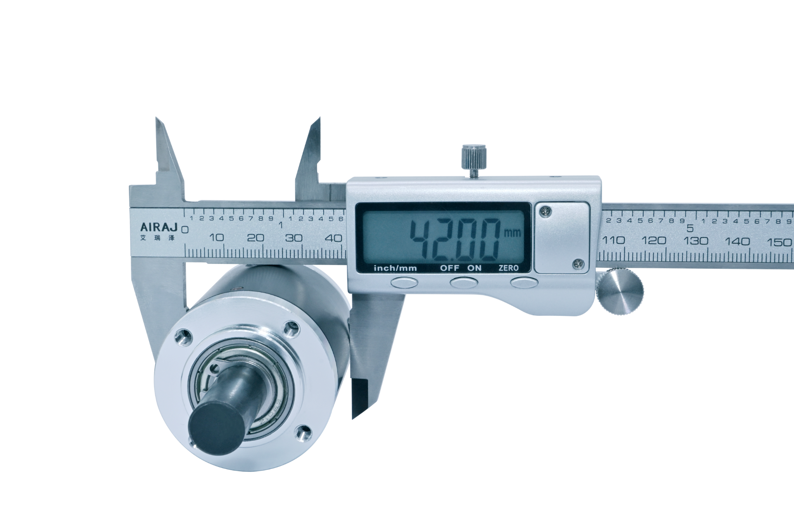

# 42 mm Compact Planetary Gearhead (42P)

[**Download Datasheet PDF**](../../assets/downloads/42p/42P_Planetary_Gearhead_Datasheet_Rev1.0.pdf){ .md-button .md-button--primary }
[**Download 2D Drawing PDF**](../../assets/downloads/42p/42P_2D_Drawing.pdf){ .md-button }
[**Download Full Assembly STEP**](../../assets/downloads/42p/42P_Full_Assembly.step){ .md-button }
[**Download Simplified 4-Stage STEP · Reference**](../../assets/downloads/42p/42P_Public_Simplified_STEP_v1.0_4-Stage.step){ .md-button }

| Ø Diameter | Reduction ratios | Gearhead body length | Rated allowable torque | Backlash |
| --- | --- | --- | --- | --- |
| **42 mm** | **3.8:1–660.7:1** | **35.6–69.5 mm** | **7845.3–14710.0 mN·m** | **≤ 1.2°** |

**Custom 42P interface or motor fit?** [Match my motor](../../request-cad-sample-quote.md?model=42P&start=existing_motor&path=gearbox_only) · [Review my drawing / STEP](../../request-cad-sample-quote.md?model=42P&start=drawing_cad) · [Replace / redesign existing gearbox](../../request-cad-sample-quote.md?model=42P&start=failing_gearbox&path=gearbox_only) · [Prototype → volume](../../request-cad-sample-quote.md?model=42P&start=prototype_to_volume)

**More:** [Stage-by-stage ratios](#stage-ratio-and-performance-table) · [Online technical specifications](../../engineering-resources/42p/datasheet.md) · [Mechanical drawing preview](../../engineering-resources/42p/mechanical-interface.md) · [All 12 models](8-42mm-planetary-gear-reducer.md)

{ width="520" loading="lazy" }

## Product Identity

| Item | Description |
| --- | --- |
| Model | 42P |
| Product type | Compact precision planetary gearhead (planetary gearbox) |
| Nominal outer diameter | 42 mm |
| Number of stages | 1 to 4 |
| Manufacturing process | Machining |

## Key Specifications

| Parameter | Published value |
| --- | ---: |
| Nominal outer diameter | 42 mm |
| Gearhead length range | 35.6–69.5 mm |
| Reduction ratio range | 3.8:1–660.7:1 |
| Rated allowable torque range | 7845.3–14710.0 mN·m |
| Maximum momentary torque range | 15690.6–29420.0 mN·m |
| Efficiency range | 66–90% |
| Backlash at no load | ≤ 1.2° |
| Permissible gearhead input speed, continuous operation | Motor/configuration dependent; confirm selected operating point |
| Operating temperature range | −40 to 120 °C |
| Housing material | Steel |
| Gear material | Steel |
| Output bearing | Ball Bearing |
| Radial load, 10 mm from flange | ≤ 16.0 kgf |
| Shaft axial load | ≤ 8.0 kgf |
| Radial play of shaft | ≤ 0.04 mm |
| Thrust play of shaft | ≤ 0.3 mm |
| Adapted DC motor voltage | 3–48 VDC |
| Adapted DC motor power | below 200 W |
| Manufacturing process | Machining |

Maximum momentary torque is not a continuous working rating.

## Stage, Ratio and Performance Table

| Stages | Gearhead length L | Available reduction ratios | Rated allowable torque | Maximum momentary torque | Efficiency |
| ---: | ---: | --- | ---: | ---: | ---: |
| 1 | 35.6 mm | 3.8 / 4.3 / 5.1 | 7845.3 mN·m | 15690.6 mN·m | 90% |
| 2 | 46.9 mm | 14.4 / 16.3 / 18.6 / 19.2 / 21.8 / 25.7 | 9806.6 mN·m | 19613.3 mN·m | 80% |
| 3 | 58.2 mm | 54.4 / 61.9 / 70.4 / 72.8 / 80.1 / 82.8 / 94.2 / 97.4 / 110.8 / 130.3 | 11768.0 mN·m | 23536.0 mN·m | 73% |
| 4 | 69.5 mm | 206.4 / 234.6 / 266.8 / 276 / 303.5 / 313.9 / 345 / 357 / 369.2 / 406 / 419.9 / 477.5 / 493.93 / 561.70 / 660.7 | 14710.0 mN·m | 29420.0 mN·m | 66% |

## Motor Compatibility

The adapted-motor sheet identifies DC motors with a nominal voltage of **3–48 VDC** and power **below 200 W**. If the motor cannot meet the gearhead installation requirements, the motor and gearhead interface details need to be negotiated separately.

These are adapted-motor conditions, not an electrical voltage or power rating for the mechanical gearhead itself. Confirm the motor shaft, mounting interface, input speed, duty cycle and operating point for the selected gearhead ratio.

## Dimensions and Interface

The published drawing shows a 42 mm body diameter and stage-dependent gearhead lengths of 35.6, 46.9, 58.2 and 69.5 mm. Use the approved drawing for shaft geometry, mounting holes, input-interface details and tolerance notation.

The current 42P specification sheet confirms steel housing and gears, Ball Bearing at the output, a radial load limit of **≤ 16.0 kgf measured 10 mm from the flange**, a shaft axial load limit of **≤ 8.0 kgf**, radial shaft play of **≤ 0.04 mm**, thrust shaft play of **≤ 0.3 mm**, continuous permissible input speed of **Motor/configuration dependent; confirm selected operating point**, and an operating temperature range of **−40 to 120 °C**.

These are published gearhead limits. The actual application load direction, duty cycle, motor operating point and selected stage / ratio still need to be checked before final selection.

## STEP Notes

The **Full Assembly STEP** is the published original Creo assembly. The **Simplified STEP** is a separate 4-stage reference for preliminary mechanical packaging. The [42P 2D outline drawing](../../assets/downloads/42p/42P_2D_Drawing.pdf) is the original **SG01PD42** interface reference. The body length **L ±0.3 mm** is configuration-dependent; confirm stage, ratio and motor mating dimensions before production.

[Back to the 8–42 mm product catalogue](8-42mm-planetary-gear-reducer.md)

**Potential OEM applications** *(suitability requires engineering review)*: [Packaging and conveyor mechanisms](../../applications/packaging-labeling-conveyor-gear-motors.md) · [Wearable exoskeleton joint components](../../applications/exoskeleton-joint-actuators.md) · [Furniture adjustment drives](../../applications/furniture-seating-adjustable-mechanism-gear-motors.md) · [Humanoid robot joint mechanisms](../../applications/humanoid-robot-joint-actuators.md) · [All applications](../../applications/index.md).

**Motor + Gearhead Assembly:** [Motor matching and custom integration](../../custom-engineering/motor-gearbox-integration.md).
