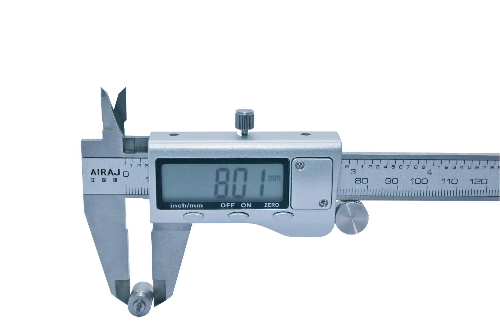

# 8 mm Micro Precision Planetary Gearhead (8P)

[**Download Datasheet PDF**](../../assets/downloads/8p/8P_Planetary_Gearhead_Datasheet_Rev1.0.pdf){ .md-button .md-button--primary }
[**Download 2D Drawing PDF**](../../assets/downloads/8p/8P_2D_Drawing.pdf){ .md-button }
[**Download Full Assembly STEP**](../../assets/downloads/8p/8P_Full_Assembly.step){ .md-button }
[**Download Simplified 4-Stage STEP · Reference**](../../assets/downloads/8p/8P_Public_Simplified_STEP_v1.0_4-Stage.step){ .md-button }

**Engineering data reference:** Use the current [8P Datasheet PDF](../../assets/downloads/8p/8P_Planetary_Gearhead_Datasheet_Rev1.0.pdf) for published input-speed conditions, ratio/stage, rated load and dimensions. Images here show real products only; if a web summary and the downloadable Datasheet differ, verify the latest controlled revision with SigGear engineering.

| Ø Diameter | Reduction ratios | Gearhead body length | Rated allowable torque | Backlash |
| --- | --- | --- | --- | --- |
| **8 mm** | **3.8:1–731.16:1** | **10.15–18.10 mm** | **19.6–39.2 mN·m** | **≤ 1.5°** |

**Custom 8P interface or motor fit?** [Match my motor](../../request-cad-sample-quote.md?model=8P&start=existing_motor&path=gearbox_only) · [Review my drawing / STEP](../../request-cad-sample-quote.md?model=8P&start=drawing_cad) · [Replace / redesign existing gearbox](../../request-cad-sample-quote.md?model=8P&start=failing_gearbox&path=gearbox_only) · [Prototype → volume](../../request-cad-sample-quote.md?model=8P&start=prototype_to_volume)

**More:** [Stage-by-stage ratios](#stage-ratio-and-performance-table) · [Online technical specifications](../../engineering-resources/8p/datasheet.md) · [Official 2D Drawing PDF](../../assets/downloads/8p/8P_2D_Drawing.pdf) · [Motor-only datasheets](../../engineering-resources/motors/index.md#8-mm-dc-micromotors) · [All 12 models](8-42mm-planetary-gear-reducer.md)

{ width="520" loading="lazy" }

## Product Identity

| Item | Description |
| --- | --- |
| Model | 8P |
| Product type | Micro precision planetary gearhead (planetary gearbox) |
| Nominal outer diameter | 8 mm |
| Number of stages | 1 to 4 |
| Housing material | Steel |
| Gearwheel material | Steel |
| Output bearing | Ball Bearing |

## Key Specifications

| Parameter | Published value |
| --- | ---: |
| Nominal outer diameter | 8 mm |
| Gearhead length range | 10.15–18.10 mm |
| Reduction ratio range | 3.8:1–731.16:1 |
| Rated allowable torque range | 19.6–39.2 mN·m |
| Maximum momentary torque range | 39.2–78.5 mN·m |
| Efficiency range | 66–90% |
| Backlash at no load | ≤ 1.5° |
| Permissible gearhead input speed, continuous operation | Motor/configuration dependent; confirm selected operating point |
| Operating temperature | −40 to 120 °C |

Maximum momentary torque is not a continuous working rating.

## Stage, Ratio and Performance Table

| Stages | Gearhead length L | Available reduction ratios | Rated allowable torque | Maximum momentary torque | Efficiency |
| ---: | ---: | --- | ---: | ---: | ---: |
| 1 | 10.15 mm | 3.8 / 4.5 / 5.2 | 19.6 mN·m | 39.2 mN·m | 90% |
| 2 | 12.80 mm | 14.4 / 17.1 / 19.8 / 20.3 / 23.4 / 27 | 24.5 mN·m | 49.0 mN·m | 80% |
| 3 | 15.45 mm | 54.9 / 65 / 75.1 / 76.95 / 88.9 / 91.1 / 102.75 / 105.3 / 121.7 / 140.6 | 29.4 mN·m | 58.8 mN·m | 73% |
| 4 | 18.10 mm | 208.5 / 246.9 / 285.3 / 292.4 / 337.9 / 346.3 / 390.46 / 400.14 / 410.1 / 462.4 / 473.85 / 534.3 / 547.56 / 632.74 / 731.16 | 39.2 mN·m | 78.5 mN·m | 66% |

## Shaft and Load Limits

| Parameter | Published value |
| --- | ---: |
| Radial load, measured 10 mm from flange | ≤ 0.4 kgf |
| Shaft axial load | ≤ 0.1 kgf |
| Radial shaft play | ≤ 0.04 mm |
| Thrust shaft play | ≤ 0.15 mm |

## Motor Compatibility

For **motor + gearhead matching**, use the downloadable [gearhead Datasheet](../../assets/downloads/8p/8P_Planetary_Gearhead_Datasheet_Rev1.0.pdf) and the [motor Datasheet library](../../engineering-resources/motors/index.md). Motor voltage/power, shaft/pinion, pilot, mounting, input speed and duty-cycle compatibility must be confirmed for the exact combination; older marketing charts are not a technical specification.

## Dimensions and Interface

The published drawing shows an 8 mm body, an M8×0.5 external thread, a 5.8 mm output-shaft extension and stage-dependent gearhead lengths of 10.15, 12.80, 15.45 and 18.10 mm. Download the official **2D Drawing PDF** above for the complete dimensional notation and tolerances.

## STEP Notes

The Full Assembly STEP is the original Creo assembly export for 8P, now available for direct download. The separate Simplified STEP is a 4-stage reference model for preliminary packaging. For dimensional verification, use the downloadable **2D Drawing PDF** and confirm its controlled production revision.

[Back to the 8–42 mm product catalogue](8-42mm-planetary-gear-reducer.md)

**Potential OEM applications** *(suitability requires engineering review)*: [Laboratory sample handling](../../applications/laboratory-automation-diagnostic-equipment-gear-motors.md) · [Optical focus and sensor positioning](../../applications/optical-imaging-camera-module-gear-motors.md) · [Micro robotics](../../applications/micro-robotics-gear-motors.md) · [Robot grippers](../../applications/robot-gripper-gear-motors.md) · [All applications](../../applications/index.md).

**Motor + Gearhead Assembly:** [Motor matching and custom integration](../../custom-engineering/motor-gearbox-integration.md).
